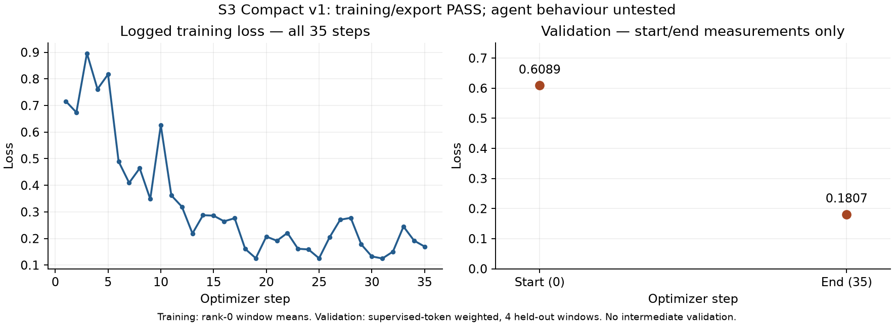

# S3 Compact, S1 Own and behaviour gate — consolidated technical report

Date: October 18, 2026 (IST). Author: Atul's execution workspace.

**Current status: E1 PASS (147/147 episodes, 182/182 edits); S3 Compact version 1 COMPLETE / training-export PASS, rc 0, all 35 steps, unchanged `--budget-h 3`. S1 and the behaviour gate require separate approval.**

This is the single report for Steps 1a, 1b, 2 and CPU E1. Earlier preflight blockers are reconciled below; detailed evidence and the original initial-stage checks remain identifiable as history. Actual S3 measurements below come from downloaded version-1 outputs; S1 and gate measurements remain unavailable because those stages were not run.

## 1. Executive Summary

The experiment objective is to test whether grounded, compact public demonstrations (S3) or the agent's own successful trajectories (S1) restore useful edit behaviour after Step C's adapter produced 114 empty patches in Step D. The intended sequence is S3 training, review, S1 training, review, then a fixed-prefix behaviour gate comparing base, S1 and S3.

The reporting correction supersedes the original request for three separate reports. No separate Step 1a, Step 1b or Step 2 report was created.

| Stage | Completed work | Current outcome |
|---|---|---|
| Workspace/Git | Authorized feature branch in the primary workspace | PASS |
| Artifact identity | Both NPZs, gate prefixes and raw row archive match all four handoff hashes | PASS; rechecked before S3 push |
| Kaggle access | Independent workspace CLI; fresh authenticated quota/inventory/status | PASS; pre-push 30.00 h available, 0 used/reserved |
| CPU E1 | Exact benchmark bases, isolated filesystem replay, initial/final teacher-blob checks | **PASS: 147/147 episodes, 182/182 edits, zero failures/unverifiable edits** |
| Step 1a S3 | Version 1 COMPLETE; rc 0; 35/35 steps; all exports verified | **TRAINING/EXPORT PASS**; behaviour untested |
| Step 1b S1 | Dataset/configuration inspected | NOT RUN; separate approval required |
| Step 2 gate | Prefix counts and harness scoring inspected | NOT RUN; separate approval required |

The original missing-provenance issue was resolved through the authoritative benchmark, not by guessing repository versions. All 150 distinct source downloads succeeded, covering 151 episode/file states. Initial and final Git blobs match teacher patch indexes in all 151 cases. The empty-file case is valid at exact zero-byte source state. E1 details and limitations are in §7.

The sole authorized S3 run completed without a budget stop. Validation loss decreased **0.6089 → 0.1807**; all four exports and the serving copy pass **410-module / 820 BF16 rank-16 tensor** checks. The notebook log reaches **1.937136 h** (~1 h 56 min), while quota moved **0 → 3.874829 h used**, leaving **26.125171 h**. This is training/export success, not a behaviour-gate result. The user withheld authorization for S1, the gate, retries and configuration changes; none occurred. E1 remains 147/147 episode and 182/182 edit PASS.

## 2. Background and Research Motivation

Sources: [handoff](step0_handoff_20261017.md), [strategy](finetune_strategy_plan.md), [training guide](post_training_guide.md), [Step C report](step_c_20261015_report.md), [Step D report](step_d_d0_20261016_report.md), [Step D diagnosis](step_d_failure_analysis_20261016.md), and [E0/E2 audit](e0_e2_audit_20261016.md).

Step C established that training, export and serving integration could work. Its preserved `train_report.json` records rc 0 and four valid 410-module exports. Its validation loss fell substantially. Step D then measured 0/114 resolved and 114/114 empty patches with that adapter. Consequently, lower imitation loss and adapter integrity cannot approve a coding-agent release.

The subsequent E2 audit identified missing action state and an imbalanced supervision mix: 80% of Step C windows started mid-run, 79% of edits lacked the edited file in that window, and scratch scripts received 56% of supervised tokens versus 17% for fixes. These are measured dataset properties; their individual causal contributions to collapse remain unisolated.

S3 compresses a demonstration to one grounded episode: locating searches, the edited region, source edits, an existing-test command when present, and submission. It drops scratch files and retains informative decisions as command comments. S1 supplies an own-policy control using v7's solved trajectories, reducing the cross-agent style change while accepting limited task diversity.

| Hypothesis | Intended evidence | Current status |
|---|---|---|
| Grounded source-edit supervision improves edit decisions | S3 edit rate at `file_in_view` at least base; overall gate rate at least base | Untested |
| Own-policy demonstrations preserve action selection | S1 gate compared with base and S3 | Untested |
| Lower update dose reduces drift | Rank 16, half Step C's peak learning rate, fewer optimizer steps | Configuration inspected; effect untested |
| Compact demonstrations can induce premature editing | Elevated edit frequency in `early` prefixes | Untested |
| Converted source-edit success feedback corresponds to executable changes | E1 at exact repository commits | Verified for 182/182 retained edits; test outcomes outside scope |

The exact handoff specifies **two epochs** for both runs. The general strategy's earlier one-epoch recommendation is historical context; it was not substituted for the prescribed command.

## 3. Step 1a — S3 Compact Training

### Dataset design, identity and measured structure

| Property | Value/source |
|---|---|
| NPZ | `data/runs/train_s3_compact.npz` |
| SHA-256 | `1893c901e1c6c8116e0696f32cdb13041fc7252a012cefd964674ae0021625b4` |
| File size | 310,099 bytes |
| Windows / distinct tasks | 147 / 147 |
| Train / validation windows | 140 / 7 |
| Train / validation tasks | 140 / 7 |
| Total input tokens | 744,278 |
| Train / validation input tokens | 704,809 / 39,469 |
| Supervised mask positions, whole NPZ | 93,746 (12.6%) |
| Maximum sequence length | 8,171 tokens |
| Matched candidate episode repositories | 132 |

Array counts were read directly from NPZ members with a standard-library NPY reader; no model or training framework was loaded. “Supervised mask positions” is the mask sum across both splits, not optimizer-processed input tokens, and not necessarily identical to shifted next-token loss counts.

The preserved compaction summary reports 147/200 kept, 40 rejected for an unseen edited region, 11 for ungrounded edits and 2 for exceeding 8,192 tokens. Median episode length is 4,942 tokens; median retained calls is 6. The preserved E2 report records no continuation windows, no leaked tool-response supervision, no unclosed call spans and 0/182 edits whose file was absent from prior window context. It attributes 75% of supervised tokens to snippet edits. These are Shrey's existing audit results, not a newly repeated tokenizer audit.

### Exact prescribed configuration

```bash
export KAGGLE_OWNER=atulbaliyan
python3 kaggle/train/make_train_notebook.py data/runs/train_s3_compact.npz --name s3_compact --lr 5e-5 --epochs 2 --grad-accum 2 --save-every 9 --budget-h 3
.venv/bin/kaggle kernels push -p kaggle/train/l4_s3_compact
```

The builder command and one push command above were executed with `KAGGLE_OWNER=atulbaliyan`. Kaggle accepted **version 1** of `atulbaliyan/gemma4-train-s3-compact`; the initial status query returned **RUNNING**. There was exactly one push attempt, no retry and no configuration change. Terminal status is now COMPLETE and the actual measurements are verified below.

| Setting | Prescribed value / source default |
|---|---|
| Training base | NF4 loading of `google/gemma-4/Transformers/gemma-4-31b-it-qat-q4_0-unquantized/2` |
| Hardware | 4×L4, FSDP |
| Adapter | `s3_compact`; rank 16, alpha 32 |
| Target projection families | q/k/v/o and gate/up/down; expected 410 actual modules |
| Peak learning rate / optimizer | 0.00005 / AdamW, weight decay 0 |
| Schedule | 5 warmup steps, then cosine |
| Epochs / accumulation / global batch | 2 / 2 / 8 windows |
| Seed / max-windows cap | 0 / none |
| Gradient clipping | Norm 1.0 |
| Offload | Sequences ≥4,097 tokens |
| Checkpoint cadence | Every 9 optimizer steps plus final |
| Validation cadence | Default `val_every=0`: start and end only |
| Budget argument | 3 session-hours; not a hard guarantee of billed usage |

Source schedule arithmetic gives 280 scheduled window presentations, 70 microsteps per rank and **35 optimizer steps**. Expected checkpoint tags are step9, step18, step27 and final, conditional on a complete run. This is more precise than the handoff's approximate 36-step description. Actual output confirms all 35 steps and all four expected checkpoint/export tags, without interruption.

### Execution identity and pass/fail checks

The notebook is **`atulbaliyan/gemma4-train-s3-compact` version 1**, pushed once, with no retry/configuration change. Kaggle status is COMPLETE. `train_report.json` records **rc 0** and the exact approved settings. All 35 planned optimizer steps completed; no `budget_stop`, OOM, traceback, non-finite validation loss or NCCL-error marker was found in the reviewed outputs.

The downloaded `train_data.npz` SHA-256 equals the approved S3 hash. All **12 downloaded trainkit/evalkit source modules** match the local submitted source, and all remote notebook cell types/source text match the submitted notebook. Remote metadata confirms version 1 and the correct L4/model/inputs, although its `last_run_time` is stale/inconsistent; it is excluded from runtime inference.

| Check | Measured result |
|---|---|
| Return code / optimizer steps | 0 / 35 of 35 |
| Per-rank microsteps / window presentations | 70 / 280 total |
| Training tasks represented | All 140 training tasks; two epochs |
| Processed training input tokens | 1,409,618 |
| Supervised next-token targets over two epochs | 177,902, reconstructed from unchanged arrays and schedule |
| Validation windows actually scheduled | 4 of 7 per pass; 2,983 supervised targets per pass |
| Expected exports | step9, step18, step27, final: all present |
| Adapter integrity | All four exports plus serving copy PASS |
| Final vs serving SHA-256 | Identical |
| Budget stop / retry | Neither occurred |

### Training and validation losses

| Measurement | Optimizer step | Elapsed from training configuration timer, min | Loss |
|---|---:|---:|---:|
| Validation start | 0 | 35.4 | **0.6089** |
| Training first | 1 | 37.4 | 0.7160 |
| Training at checkpoint | 9 | 55.2 | 0.3484 |
| Training at checkpoint | 18 | 76.4 | 0.1608 |
| Training at checkpoint | 27 | 96.2 | 0.2705 |
| Training last | 35 | 115.3 | 0.1697 |
| Validation end | 35 | 115.7 | **0.1807** |



The validation decrease is **0.4282**, approximately **70.3%**. Validation was measured only at start/end (`val_every=0`); the figure deliberately does not invent intermediate validation points. The 35 training losses range **0.1249–0.8962**, with minimum at step 31 and maximum at step 3. Training loss is not monotonic across variable batches (for example step 27 exceeds step 18). A smooth convergence/plateau or absence of overfitting cannot be established from two validation measurements.

Training metrics average rank-0 window losses, while validation weights by supervised-token count across ranks. These are different estimators. The validation decrease is meaningful for the four scheduled held-out examples, but cannot demonstrate coding-agent behaviour, broad generalization or superiority to Step C on a different dataset.

The four evaluated validation tasks are `oduwsdl__MementoEmbed-131`, `rsheftel__pandas_market_calendars-11`, `statsmodels__statsmodels-8339`, and `hhm970__c10-games-tracker-project-88`. The group-of-four scheduler omits `Ouranosinc__xclim-488`, `pre-commit__pre-commit-933`, and `mozilla__bleach-722`. This is a limitation of the unchanged prescribed scheduler, not a post-hoc task selection or a change to the split.

### GPU performance, runtime and numerical observations

| Measurement | Actual S3 result |
|---|---:|
| Model load | 1,879 s (31.32 min) |
| Model-ready configuration-clock elapsed | 34.9 min |
| Model memory after wrapping | 4.64 GiB per logged rank |
| Median global throughput | **299.3 input tokens/s** |
| Per-step global throughput range | 241.0–351.8 input tokens/s |
| Work-weighted throughput | 294.293 input tokens/s |
| Global peak allocated memory | **18.86 GiB**, below the 21 GiB check |
| Notebook maximum elapsed log timestamp | **6,973.689619 s / 1.937136 h** |
| Final training-metrics timer | 115.7 min / 1.928333 h |
| Billed GPU quota delta | **3.874829 h** |
| Quota h / notebook log elapsed h | **2.000288×**, approximate session-accounting ratio |

All four rank logs contain 35 step events. Reconstructing each step's global token SUM and maximum rank elapsed time agrees with all **35/35 logged throughput values**, within their rounding precision. The 18.86 GiB peak is the distributed maximum, not a sum over GPUs or a measured utilization percentage. No continuous GPU-utilization sampling is available.

The recorded gradient norm is the value returned by `clip_grad_norm_(1.0)`, i.e. the pre-clipping norm. It peaks at **1,208 at step 6**, with another large value **103 at step 8**; the full range is 0.295–1,208. These spikes are technical observations, not evidence of a failed optimizer step: clipping remained configured, the run stayed finite and completed. Their cause has not been isolated.

Non-fatal reviewed warning classes were one `UserWarning` about barrier device inference and two `SyntaxWarning` notices for invalid escape sequences (`\|`, `\_`). There is no observed traceback, OOM, budget-stop event or NCCL-error marker. No configuration was changed to address warnings.

### Checkpoint and final export verification

| Export | Timer, min | Modules / tensors | Bytes | SHA-256 |
|---|---:|---|---:|---|
| step9 | 55.2 | 410 / 820 | 244,982,352 | `e7adb1dc73aff952129fbf98fdd3436846cb04aa511afc5693102dc8363c1ca8` |
| step18 | 76.4 | 410 / 820 | 244,982,352 | `3c232c06233e9893f9e345a4632288b67c15b60c4369c4940a26cc0e03ed1cab` |
| step27 | 96.3 | 410 / 820 | 244,982,352 | `9d7cc1b3f5a74f6ff079b6811dc980ab0dda1583de6243fd7c5a70b2749930e2` |
| final | 115.7 | 410 / 820 | 244,982,352 | `74c041da7cc4540d617463e769173942db80a5d2c60b2ba615c4afc38c616caa` |
| serving_copy | copy | 410 / 820 | 244,982,352 | `74c041da7cc4540d617463e769173942db80a5d2c60b2ba615c4afc38c616caa` |

Every file passed BF16 dtype, rank-16 A/B orientation, pairing, two-dimensional shape, contiguous/non-overlapping tensor-offset and exact file-length checks. PEFT configuration verifies rank 16, alpha 32, dropout 0 and the prescribed target projection set. Final module-family counts are q/k/o/gate/up/down = 60 each and v = 50, totaling 410. Final and serving copies have identical SHA-256; all three earlier checkpoints have distinct hashes.

**Verdict: training/export PASS.** All handoff checks are met. Serving and the behaviour gate have not been run for S3; no claim of successful model-side source-edit proposals or improved issue resolution follows from this result.

## 4. Step 1b — S1 Own Training

The handoff identifies the data as 82 solved v7 runs on 21 old-54 tasks, with the local sandbox's `wrapt` warning stripped from 783 responses. These provenance details are inherited from the handoff; original own-run conversion was not repeated.

| Property | Measured NPZ value |
|---|---|
| NPZ | `data/runs/train_s1_own.npz` |
| SHA-256 | `d3ade3498e4b3b10048fa983c3bda4ddbccdbd302cd0f028769d0d258a8655bc` |
| File size | 345,771 bytes |
| Windows / distinct tasks | 154 / 21 |
| Train / validation windows | 133 / 21 |
| Train / validation tasks | 18 / 3 |
| Input tokens, both splits | 1,083,946 |
| Train / validation input tokens | 933,475 / 150,471 |
| Supervised mask positions, both splits | 192,809 (17.8%) |
| Maximum sequence length | 8,189 tokens |

```bash
export KAGGLE_OWNER=atulbaliyan
python3 kaggle/train/make_train_notebook.py data/runs/train_s1_own.npz --name s1_own --lr 5e-5 --epochs 2 --grad-accum 2 --save-every 9 --budget-h 3
.venv/bin/kaggle kernels push -p kaggle/train/l4_s1_own
```

These are unexecuted prescribed commands. Expected identity: `atulbaliyan/gemma4-train-s1-own`. Settings otherwise match S3. The current scheduler groups four windows and truncates incomplete groups: `floor(133×2/4)=66` microsteps per rank, yielding **33 optimizer steps** and 264 window presentations rather than all 266. Which two presentations are omitted depends on the deterministic shuffled schedule; no task-coverage conclusion was derived here. Expected checkpoint tags are step9, step18, step27 and final.

No S1 `train_report.json`, `metrics.jsonl`, `run.log`, checkpoints or exports were produced. Loss convergence, validation performance, memory, throughput and runtime warnings are unavailable. New S1 GPU consumption is zero because it was not submitted.

**Verdict: NOT STARTED / NOT AUTHORIZED.** It cannot proceed without separate user approval, even after S3 is COMPLETE and reviewed. The small set of distinct tasks limits generalization claims even if future training loss and gate results are favorable.

## 5. Comparative Analysis — S3 vs S1

| Dimension | S3 Compact | S1 Own | Step C historical reference |
|---|---|---|---|
| Demonstrations | Compact converted external trajectories | Own v7 solved runs | Converted external trajectories in multiple windows |
| Windows / tasks | 147 / 147 | 154 / 21 | 1,017 / 200 |
| Total input tokens | 744,278 | 1,083,946 | About 7.37M |
| Supervised mask share | 12.6% | 17.8% | About 16% |
| Peak learning rate | 5e-5 planned | 5e-5 planned | 1e-4 actual |
| Epochs | 2 planned | 2 planned | 1 actual |
| Optimizer steps | **35 actual** | 33 planned | 122 actual |
| Validation trajectory | **0.6089 → 0.1807** (4 windows) | Not run | 0.7718 → 0.3133 → 0.2909 → 0.2883 → 0.2882 |
| Export integrity | **step9/18/27/final + serving: all PASS** | Not run | step40/80/120/final: 410 modules, shapes valid |
| Behaviour | Unmeasured | Unmeasured | D: 114/114 empty patches, 0/114 resolved |

S1 has approximately 1.32× S3's training-split input tokens and much less task diversity. Similar optimizer-step counts therefore do not mean matched token exposure, supervised-token exposure or compute. S3's 75% edit-token share from E2 must not be confused with its 12.6% overall supervised-mask density: these use different denominators.

The historical Step C values above were checked against its preserved report and metrics. Its first logged step loss is **1.7400**, its last is **0.3897**, median logged throughput **294.8 tokens/s**, and maximum logged global peak **18.88 GiB**. These exact values take precedence here over the guide's approximate initial training-loss description. This is a historical comparison, not a rerun.

| Step C validation point | Measured loss |
|---|---:|
| Start | 0.7718 |
| Step 40 | 0.3133 |
| Step 80 | 0.2909 |
| Step 120 | 0.2883 |
| End | 0.2882 |

The table provides the actual historical Step C loss trajectory; the measured S3 curve is in §3. S1 has no curve because it was not run. Even eventual lower validation loss across S3 and S1 would not rank their behaviour: validation tasks, targets and token distributions differ. No causal attribution among grounding, compression, reasoning retention, teacher style and dose is possible from configuration inspection alone.

## 6. Step 2 — Behaviour Gate

### Setup and exact intended configuration

```bash
export KAGGLE_OWNER=atulbaliyan
python3 kaggle/eval_l4/make_eval_notebook.py v7_noedit --gate --gate-adapters s1_own,s3_compact --adapter-from atulbaliyan/gemma4-train-s1-own --adapter-from atulbaliyan/gemma4-train-s3-compact
.venv/bin/kaggle kernels push -p kaggle/eval_l4/gate_kernel
```

The gate would serve the W4A16 base and both final adapters in one scorer-configured vLLM server. Adapter provenance must be established by training version and verified export hashes before use; neither new adapter exists from this workflow. `gate_report.json` was not generated.

The verified prefix file SHA-256 is `d07b5ef760aa4dd917800c2eb7641337d62e4b095b9fc26a31583bd4acf95e12`. Direct JSON inspection confirms 30 prefixes. The handoff specifies four samples each: 120 expected responses per model, 360 total. The inspected request uses temperature 0.2, top-p 0.95, top-k 40, `max_tokens=1024`, automatic tool choice and `enable_thinking=False`. This is a one-response diagnostic, not a full task evaluation under v7's normal output allowance.

| Model | Intended identity | Verdict | Overall pass rate | Edit rate at file_in_view | Batched / no-call / request errors |
|---|---|---|---|---|---|
| Base | Unadapted served base with v7 prompt/tools | NOT RUN | N/A | N/A | N/A / N/A / N/A |
| S1 | Final `s1_own` from its separate training notebook | NOT RUN | N/A | N/A | N/A / N/A / N/A |
| S3 | Final `s3_compact` from its separate training notebook | NOT RUN | N/A | N/A | N/A / N/A / N/A |

### Complete per-type table

| Type | Prefixes | Planned responses per model | Harness pass condition, exactly one call | Base | S1 | S3 |
|---|---:|---:|---|---|---|---|
| `file_in_view` | 8 | 32 | Classified source edit | N/A | N/A | N/A |
| `test_failed` | 8 | 32 | Edit or read; command differs from prior command | N/A | N/A | N/A |
| `test_passed` | 6 | 24 | `submit_patch` | N/A | N/A | N/A |
| `early` | 8 | 32 | Read/search | N/A | N/A | N/A |
| Total | 30 | 120 | Type-specific condition plus one call | N/A | N/A | N/A |

A candidate PASS requires `edit_rate_file_in_view >= base`, overall `pass_rate >= base`, zero batched responses and zero request errors. No-call responses fail individual decisions. The base is the reference, rather than a candidate with an independently assigned adapter verdict. Future reporting must also verify expected response coverage; the harness excludes request-error rows from scored-rate denominators, so a percentage alone is insufficient.

### Early category, proposal validity and limitations

S3's compact locate→edit ordering could cause edits before sufficient investigation. That is a hypothesis to inspect in `early`, using its actual edit/read/test/no-call distribution, not merely the aggregate rate. There are currently no generated `early` responses.

The inspected `kind()` classifier identifies an edit by the presence of `PYEOF` and `write_text(` in a shell command. This is a syntactic heuristic. It does not execute the command, prove the target is eligible repository source, check a unique replacement or validate the resulting diff. A future classified edit rate must therefore not be presented as an executed source-edit success rate. `write_file` has its own tool label and is not automatically counted as an edit by this classifier.

No model-side tool failures, missing-edit rates, batching frequencies or gate infrastructure failures have been measured in this workflow. The gate's GPU request path remains untested. If infrastructure fails after a future authorized push, preserve outputs and request authorization before modifying `gate.py` or resubmitting, as the task requires.

## 7. CPU E1 Replay Audit

**Current verdict: PASS, 147/147 episodes and 182/182 source edits.** The source-provenance and isolation blockers are resolved; no dataset correction is needed. All edit assertions apply and change the intended file, with final file contents matching the teacher patch blob IDs. There are zero confirmed failures and zero unverifiable retained edits.

The initial static-only check identified 823 paired calls, 182 edits and one ambiguous empty-old operation in reconstructed display text. It did not constitute replay. The subsequent exact-commit source recovery and isolated filesystem audit below supersede its incomplete status. In particular, the empty-file case is now verified against the actual zero-byte file.

Source-edit replay does not verify tests, issue resolution or model behaviour. The compactor's synthesized test `status=ok` / exit-0 fields and tailed pipelines remain a distinct feedback-fidelity limitation, not a demonstrated source-edit failure.

### 7.1 Provenance recovery and completed CPU edit replay

**Result: PASS, 147/147 episodes and 182/182 edits; E1's source-edit replay blocker is resolved.** No episodes were removed, and all four handoff hashes remain unchanged.

#### Exact instruction and corrected decision

The [handoff](step0_handoff_20261017.md#atul-e1-cpu-in-parallel-with-the-gpu-steps) labels the work **“Atul: E1 (CPU, in parallel with the GPU steps)”** and says:

> Every kept edit must apply (`s.count(old) == 1`) and change the intended file.

It then requires reporting edits that do not apply and says **“Those get dropped before training.”** The separate [Codex prompt](atul_codex_step1.md), item 5, also says **“In parallel on CPU (no torch, no model)”**. These instructions explicitly authorize parallel execution. They require removal of confirmed failures before training; they do not state a universal rule that every episode's E1 replay must finish before any training can start. The initial universal prerequisite was our interpretation, not Shrey's explicit instruction. This follow-up corrects it without treating static checks as replay.

The distinction no longer determines whether the data can proceed: the full retained source-edit set has now been replayed successfully. Training still needs the independently specified resource approval.

#### Recovery paths examined and authoritative source

| Path | Evidence and outcome |
|---|---|
| Original teacher rows | All 200 preserved rows inspected; explicit `base_commit` is absent. 52 rows contain Git provenance-related commands, but no commits were guessed from those commands or issue numbers. |
| Recovered compact episodes | Exact task-ID join identifies 147 candidates in the 840-trace S3-1k archive; all 147 trajectory IDs match preserved teacher rows. |
| Preprocessing source and metadata | `convert_public.py` identifies the source as `nebius/SWE-rebench-openhands-trajectories`; it saves instance/trajectory IDs but omits benchmark base commits. The compact trace retains that limited source object. |
| Kaggle/local records | Existing training manifests describe tokenized inputs and outputs, not these external task base revisions. No S3 GPU run existed from which additional source state could be recovered. |
| Recovery checkout / verified backup | Read-only filename inventory and the October 16 backup manifest found no S3/rebench provenance manifest; the backup predates Step 0. Neither checkout nor backup files were modified. |
| Public benchmark metadata | The upstream trajectory card identifies SWE-rebench as its task source. An exact instance-ID/repository join against the benchmark recovered **147/147 base commits**. |

Authoritative sources: [Nebius trajectory dataset](https://huggingface.co/datasets/nebius/SWE-rebench-openhands-trajectories), [pinned benchmark metadata](https://huggingface.co/datasets/nebius/SWE-rebench/tree/89cdfbab4ab1bd8f5a658bb212d1b63624f4f881), and [benchmark schema](https://huggingface.co/datasets/nebius/SWE-rebench/blob/89cdfbab4ab1bd8f5a658bb212d1b63624f4f881/README.md). The schema defines `base_commit` as the source HEAD before the solution PR; `environment_setup_commit` is a different field and was not substituted.

The dataset-viewer filter route returned HTTP 500. Recovery therefore used pinned Parquet HTTP range reads of only `instance_id`, `repo`, and `base_commit`, not the 245 MB whole benchmark or 2 GB trajectories export. The metadata projection transferred **1,643,764 bytes** across the two test shards and recovered all 147 tasks without ambiguity. Each repository identity was checked against its preserved teacher row.

Only files targeted by retained edits were fetched from `raw.githubusercontent.com/<repo>/<exact-base-commit>/<path>`. All **150 distinct repo/commit/path downloads** succeeded, totaling **2,645,508 source bytes**. There are **151 episode/file states** because one pinned file is shared by more than one episode. No repository clone, Docker image, model download, setup script or test suite was needed.

#### Replay method and results

A disposable bubblewrap namespace was verified using an audit-owned filesystem check outside the outer tool sandbox. The replay used a read-only Python runtime, read-only source/plan inputs, a temporary writable filesystem, a designated audit-output directory, and **no network**. No teacher shell or Python program was executed. No project setup, import or test code was executed.

Before replay, each generated command's Python AST had to equal the canonical conversion algorithm: import `pathlib`, bind a literal target path, `read_text`, bind literal `old`/`new`, assert exactly one occurrence, and `write_text(s.replace(old, new))`. Only safe relative paths were accepted. The audit-owned implementation then performed that same operation on actual temporary files initialized from the pinned source bytes. It checked mutation, exact expected output bytes, target-file containment, recorded edit feedback and final Git blob identity. This is filesystem edit replay with an equivalent validated operation, not host execution of teacher code or a full software-test evaluation.

| Required measurement | Result |
|---|---:|
| Episodes examined | 147 |
| Episodes with verified source revision and all targeted files | 147/147 |
| Episodes whose complete edit chains replayed | 147/147 |
| Edits successfully applied and changed intended source | 182/182 |
| Confirmed edit failures | 0 |
| Edits unverifiable due to missing provenance/source | 0 |
| Initial episode/file Git blobs matching teacher patch index | 151/151 |
| Final episode/file Git blobs matching teacher patch index | 151/151 |
| Mismatched source-edit success feedback | 0/182 |
| Undeclared files materialized/modified in replay trees | 0 |

The teacher patch supplies abbreviated Git index IDs; the downloaded source and replayed output were hashed with Git's complete blob algorithm and required to match those prefixes. Exact commit-addressed retrieval and agreement with both patch endpoints corroborate the source association. Full SHA-256 file hashes and full computed Git blob IDs are retained in local evidence. No merely similar source file was accepted.

#### Empty-file case — resolved at byte level

For `ithaka__apiron-40`, base commit **`a75eb697f27dcabaa7366f7859f192ad5b387b4f`**, target `apiron/__init__.py` is **exactly zero bytes**. Its SHA-256 is `e3b0c44298fc1c149afbf4c8996fb92427ae41e4649b934ca495991b7852b855`, and Git blob ID is `e69de29bb2d1d6434b8b29ae775ad8c2e48c5391`, matching teacher index `e69de29`.

For the actual empty string, `s.count("") == 1`; the converted call therefore passes its assertion. The replacement creates 599 characters, changes the correct file, and yields Git blob `8842928fe5733279125ceee6243370b70e4a41b7`, matching teacher final index `8842928`. Output SHA-256 is `3b5dc6ccb0c07a315d81c434c171c9e6dc93d91442a14c497775dd0d1cd7abe4`. The previous one-newline retained read was a display reconstruction artifact, not the original source bytes. There is no confirmed conversion failure here.

#### Scope and remaining limitations

E1 now verifies the retained source-edit transitions and their final source-file states. It does not verify teacher test execution, test success, issue resolution or all removed intermediate actions. The earlier observation about synthesized test/pipeline success fields remains a separate data-fidelity concern; zero source-edit feedback mismatches does not clear every kind of feedback. Matching candidate IDs plus source/final blob identities still does not claim a fresh tokenizer-level E0 reproduction of the missing original compact directory.

No data correction is justified by these replay results. No NPZ, original archive, converter, compactor or generated notebook was hand-edited. No GPU, torch or model inference was used for E1. The audit's PyArrow reader was installed only under `/tmp` for metadata access; it is not a training/runtime change.

The small [E1 summary and complete per-episode source manifest](../data/runs/atul_e1_replay_20261018/summary.json) records all 147 instance/repository/base-commit mappings, source paths, initial/final Git blob hashes and results. Full local replay evidence is `data/runs/atul_e1_replay_20261018/e1_replay_report.json`; raw downloaded source files and detailed inputs remain uncommitted. Audit-owned utility copies and SHA-256 values are preserved locally under that folder's `audit_tools/`.

## 8. GPU Runtime and Quota Accounting

The completed S3 run is the only new GPU experiment. Pre-push quota was **30.00 h total/available, 0 used/reserved** at 02:20:31 IST. The first actual terminal query was at **06:42:27 IST** (`2026-10-18T01:12:27.705660+00:00`), and a later verification at **08:52:04 IST** found the same charge: **3.874829444 quota h used**, **26.125170556 h remaining**, none reserved.

| Run | Handoff forecast session / quota h | Approved pre-push forecast | Actual execution / quota | Available before → after |
|---|---|---|---|---|
| S3 v1 | ~1.4 / ~3.0 | 2.1–2.4 / 4.2–4.8 | **1.937136 notebook-log h / 3.874829 quota h** | **30.000000 → 26.125171 h** |
| S1 | ~1.7 / ~3.5 | Not authorized | **Not run; 0** | No run-boundary measurement |
| Gate | ~0.6 / ~1.2 | Not authorized | **Not run; 0** | No run-boundary measurement |
| Total new usage | ~7.7 quota h for original full plan | Only S3 approved | **3.874829 quota h** | **26.125171 h remains** |

S3 finished below the approved 3 h budget, below the revised 2.1–2.4 h forecast and above the original handoff's 1.4 h estimate. The ratio of billed quota to the notebook's independently recorded elapsed-log duration is **2.000288×**, consistent with historical ~2× billing. This ratio uses a log-duration proxy, not independently verified backend GPU allocation start/end timestamps.

Runtime evidence has limits. The notebook log's maximum relative time is **6,973.689619288 s**; final metrics reach 115.7 min. The configuration's absolute `t0` is `2026-10-17T21:08:57.494513+00:00`. The pull API reports `last_run_time=2026-10-15T03:16:05.518000`, inconsistent with this newly submitted version; it is excluded. Time between push and a later COMPLETE observation is **not** treated as session runtime. Exact absolute backend finish time was not verified.

The quota ledger in [the guide, §8](post_training_guide.md#8-gpu-quota-ledger) records actual usage separately. Historical preflight and submission evidence follows; it does not represent additional runs or charges.

### 8.1 GPU preflight and one-run approval

A separate **primary-workspace `.venv`** was created with `include-system-site-packages=false`. It contains Kaggle CLI **2.2.4** and its dependency graph, installed through `pip install kaggle`; no training/model framework was installed there. Authentication was verified through the existing authorized login flow. No Kaggle credentials were copied, printed or inspected. The recovery checkout's virtual environment is no longer needed for handoff commands.

Fresh authenticated inventory/quota snapshot: **October 18, 2026, 02:08:10 IST** (`2026-10-17T20:38:10.088452+00:00`). Total GPU quota **30.00 h**, used **0.00 h**, reserved **0.00 h**, available **30.00 h**. The inventory belongs to `atulbaliyan`; the three project notebooks are COMPLETE and the two older unrelated notebook sessions return 404. No queued/running notebook was returned, and no S3/S1 training notebook existed in the inventory. Refresh these checks again immediately before an approved push.

The exact S3 builder command in §3 was executed locally with `KAGGLE_OWNER=atulbaliyan`. The builder compiled all code cells and generated **37 cells / 459,501 normalized source bytes**, below the 1,000,000-byte limit. Metadata was verified:

- Identity: `atulbaliyan/gemma4-train-s3-compact`; private; GPU enabled; Internet disabled; `machine_shape=NvidiaL4`.
- Data embedded from the unchanged S3 NPZ; no newer S3-1k data substituted.
- Model: `google/gemma-4/Transformers/gemma-4-31b-it-qat-q4_0-unquantized/2`.
- Inputs: official metric wheelhouse, competition, and Shrey's scorer-env/train-wheels outputs.
- Settings: `name=s3_compact`, `lr=5e-5`, `epochs=2`, `grad_accum=2`, `save_every=9`, `val_every=0`, `budget_h=3`, `smoke=false`, no max-windows cap.

Read-only API checks at 02:11:05 IST confirmed access to both shared kernel outputs (`scorer_env.tgz` and the two training wheels) and the official wheelhouse (41 listed files, no further page). The generated notebook is 467,033 bytes on disk, SHA-256 `b93e23c6065f61c6ef6e312a0ef002ba4065950499860e3d944f44a1f79a669a`; its normalized source is 459,501 bytes. Both are below 1 MB.

The generated notebook remains a local, uncommitted build artifact, with a copy archived under `data/runs/atul_s3_compact/submitted_notebook_v1/`. Exactly one subsequent push was accepted as version 1. S1 and gate require separate user approval as well as preceding-stage checks.

The exact deterministic schedule was recalculated without importing torch:

| Measurement | S3 | S1 |
|---|---:|---:|
| Scheduled training input tokens | 1,409,618 | 1,855,104 |
| Window presentations | 280 | 264 |
| Optimizer steps | 35 | 33 |
| Omitted training presentations | 0 | 2 |
| Declared validation windows | 7 | 21 |
| Actually scheduled validation windows per pass | 4 | 20 |
| Scheduled validation input tokens per pass | 25,076 | 143,444 |

Validation uses the same group-of-four scheduler: S3's validation loss will cover **4 of 7** held-out tasks/windows, not all 7; S1 uses 20 of 21 held-out windows. This is a source-derived limitation of the unchanged configuration, not a measured new loss or a code fix. It must accompany future loss reporting.

Step C's actual model event records **2,243 s load** and `t_min=43.9`, which includes startup before that event; its initial validation completed at 48.7 min. Using actual scheduled training tokens and **280 tokens/s**, adding 43.9 min through model initialization gives approximately **2.13 session h S3** and **2.57 session h S1**, before their own validation/export overhead. Using Step C's raw median 294.8 tokens/s gives about 2.06 and 2.48 h respectively. These are estimates, not measurements of the new runs; sequence-length efficiency can change them.

For authorization planning, use **S3 ~2.1–2.4 session h / ~4.2–4.8 quota h**, **S1 ~2.6–2.9 session h / ~5.2–5.8 quota h**, and the handoff gate estimate **0.6 session h / ~1.2 quota h**: total approximately **10.6–11.8 quota h**. Setup, validation/export and Kaggle accounting remain uncertain. S1 may approach the existing 3 h budget's stop-taking-steps threshold at 2.6 h; do not change its flags silently or call a budget-stopped run complete training.

**Approval received for Step 1a only:** the user explicitly approved exactly one S3 run with the unchanged 3 h budget and exact handoff parameters. Expected duration remains below that budget. The user requires fresh preflight, one submission, no automatic retry, and separate approval for S1 and the gate. This is not approval for the cumulative >10 h plan. At pre-push time no quota has yet been spent; record actual run usage from fresh before/after snapshots.

### 8.2 Approved S3 version 1 submission and monitoring

Before push, fresh authenticated quota at **02:20:31 IST** was **30.00 h available, 0 used, 0 reserved**, with no queued/running notebook. All four hashes were rechecked. AST compilation, exact settings, metadata inputs/namespace and embedded data identity passed. The normalized notebook source is **459,501 bytes**, on-disk notebook **467,033 bytes**, unchanged SHA-256 `b93e23c6065f61c6ef6e312a0ef002ba4065950499860e3d944f44a1f79a669a`.

The user explicitly approved **exactly one** S3 run with the unchanged 3 h budget. Expected duration remained **2.1–2.4 session h / 4.2–4.8 quota h**, below the approved session budget; the quota ledger was updated **before** push. The command `.venv/bin/kaggle kernels push -p kaggle/train/l4_s3_compact` returned **“Kernel version 1 successfully pushed.”** The initial status query returned **RUNNING**. No second push was issued.

Run: [atulbaliyan/gemma4-train-s3-compact](https://www.kaggle.com/code/atulbaliyan/gemma4-train-s3-compact). Local `summary.json` and the exclusive-create `preflight_20261018/push_attempt.json` record the sole attempt and version. Monitoring recovered terminal outputs and is paused after review. The original requested monitoring cadence was ten minutes; the effective persisted automation cadence was thirty minutes. Actual snapshots include 21:36 and 22:06 UTC on October 17; the terminal check executed later than its heartbeat trigger. Ten-minute observation coverage is therefore **not** claimed. Use the actual snapshot timestamps, not scheduled heartbeat times.

Terminal output download exited **0** and retrieved all pages, including all five adapter files, report, metrics, run/rank/notebook logs, source modules and exact input NPZ. `analysis/validate_training_run.py` was inspected and run with stdlib only; its historical stage label was overridden to S3 in a new result file. All checks PASS. No original result/model artifact was changed. S1, the behaviour gate, retries and configuration changes remain unauthorized.

## 9. Major Findings and Technical Analysis

1. **S3 training/export succeeded:** rc 0; 35/35 steps; 1,409,618 input tokens; validation 0.6089→0.1807; all four exports and serving copy pass integrity checks; no budget stop or retry.
2. **E1 remains fully verified:** 147 episodes, 182 edits and 151 initial/final episode-file blob matches. The empty-file operation is valid; no NPZ correction was made.
3. **Loss improvement tests imitation, not behaviour:** the gate has not run. S3 has no measured edit rate, nonempty-patch rate or issue-resolution score.
4. **Validation coverage is small:** only 4 of 7 held-out windows and 2,983 supervised targets per pass; only start/end validation. No claim of stable convergence, optimal checkpoint or no overfitting is warranted.
5. **Numerical spikes and warnings did not prevent completion:** preclip gradient norms reached 1,208; three non-fatal warning notices were observed. Their cause/behavioural consequences are not established.
6. **Resource use was within approval:** 18.86 GiB peak and ~1.937 notebook-log h; 3.874829 quota h, below the revised estimate. Exact backend absolute session boundaries remain unavailable.
7. **Execution identity is corroborated:** remote version/cell sources, downloaded code and input hash match the approved submission. The inconsistent metadata date is not used for runtime.
8. **Monitoring was less frequent than requested:** effective thirty-minute cadence and delayed terminal processing are documented. They do not imply that the GPU ran until the later check or exceeded its budget.

S3 and Step C use different datasets, state preservation, token weights and update doses. The improved S3 final validation loss cannot isolate which change matters or establish superiority. S1 is unrun, so the intended own-policy control comparison remains unavailable. No paired significance result is reported without paired behavioural outcomes.

## 10. Recommendations and Future Research

**Stop at the completed S3 review.** The authorized run has passed its training/export checks; S1 and the gate require separate user approval. Preserve final S3 and checkpoints without selecting one using unrun evaluation outcomes.

| Next action | Evidence required / authorization | Cost status |
|---|---|---|
| E1/source-data correction | No correction indicated: 182/182 retained edits passed | Complete, 0 GPU h |
| S3 training/output review | Complete; final and serving hashes equal | Actual 3.874829 quota h |
| S1 own-policy control | Separate approval, fresh quota/no-conflict check, unchanged prescribed flags unless explicitly changed | Prior forecast 5.2–5.8 quota h; **unmeasured**, do not launch |
| Behaviour gate | Separate approval after required training; full per-type/early/batch/no-call results | Prior forecast ~1.2 quota h; **unmeasured**, do not launch |
| Data/scheduler improvement | Preserve exact provenance; consider validating all held-out windows and true test feedback in a separately reviewed change | CPU design work only, not performed here |

With current S3 charge and the prior remaining-stage forecasts, the whole sequence would total approximately **10.27–10.87 quota h** before further overhead; that is a planning estimate, not new permission. The account currently retains **26.125171 quota h**. Future approval must cover each >2 h session and the >10 h cumulative threshold as applicable.

The next scientific question is whether S3 improves correctly timed source-edit decisions without premature `early` edits. Reduced loss cannot answer it. Preserve the own-run control and planned gate rather than jumping to task evals, S3-1k, S4, DPO/RL or extra retraining. All such GPU work remains outside this approval.

## 11. Final Conclusion

**Step 1a S3 Compact is COMPLETE / training-export PASS.** One approved version, unchanged configuration, rc 0, all 35 optimizer steps, validation loss **0.6089→0.1807**, and valid **410-module** checkpoint/final exports were verified. Final and serving copies match SHA-256 `74c041da7cc4540d617463e769173942db80a5d2c60b2ba615c4afc38c616caa`.

The run used **3.874829 quota h**, leaving **26.125171 h**; notebook logs support **1.937136 h** execution duration, within the approved 3 h budget. E1 is **147/147 episode, 182/182 edit PASS**, with no data changes.

This supports feasibility of the compact-data training recipe, not improved coding-agent behaviour. S1 and the behaviour gate were not run. Monitoring is paused after terminal review; no retry, next-stage launch or configuration change is authorized. Prioritize the separately approved control/gate before any claim of behavioural recovery from Step D.

### Evidence and delivery record

- Inspected source baseline: `fc29e53` on `main`, matching freshly fetched `origin/main` before the results branch was created.
- Authorized branch: `atul/s3-s1-gate-results`.
- Local supplemental preflight evidence, not experiment outputs: `data/runs/atul_s3_s1_gate_preflight_20261018/kaggle_preflight.json` and `static_preflight.json`.
- Historical measured loss/export source: `data/runs/atul_step_c_corrected_20261015_v2/train_report.json` and `train_out/metrics.jsonl`; historical runtime interpretation from its report/guide and Step D's final report.
- Static source checks: `posttrain/compact_episodes.py`, `posttrain/convert_public.py`, `kaggle/train/trainkit/{config,data,worker,main}.py`, and `kaggle/eval_l4/evalkit/gate.py`.
- No credentials were inspected, copied or exposed; only the existing CLI/SDK authentication flow was used. Its preserved installation was invoked with Python bytecode writes disabled.
- Recovery working files and Kaggle artifacts were preserved. Git uses administrative metadata under the recovery checkout's `.git/worktrees/` for this linked worktree; the authorized pull and feature-branch operations necessarily updated that shared metadata.
- Exactly one approved S3 notebook was pushed as version 1 and completed successfully. Raw outputs and adapters remain local/uncommitted; only permitted small evidence and documentation are committed. No teacher-command execution, dataset regeneration, paired task evaluation, leaderboard submission, S1/gate run or automatic next-stage experiment occurred.
