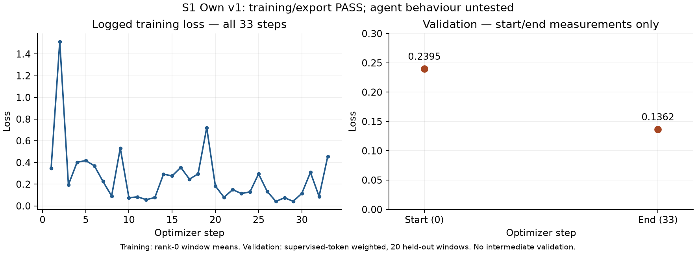
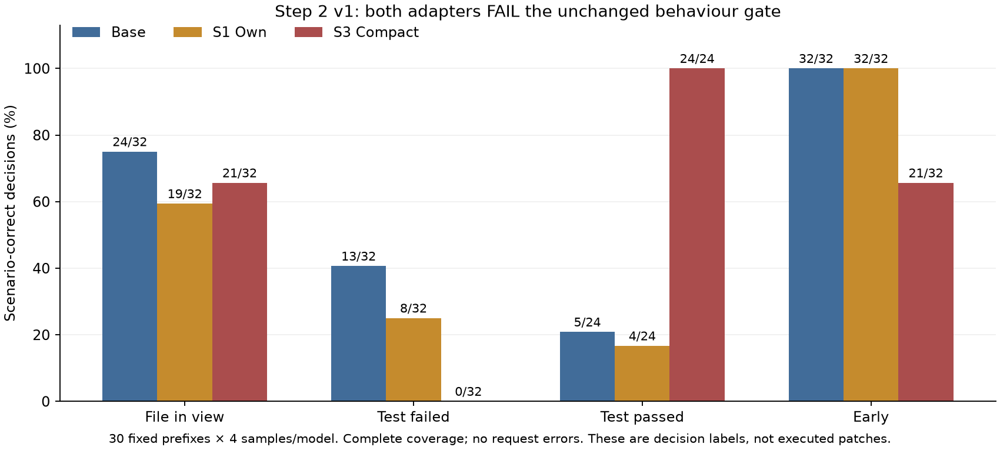

# S3 Compact, S1 Own and behaviour gate — consolidated technical report

Date: October 18, 2026 (IST). Author: Atul's execution workspace.

**Current status: E1 PASS (147/147 episodes, 182/182 edits); S3 Compact version 1 COMPLETE / training-export PASS, rc 0, all 35 steps, unchanged `--budget-h 3`. S1 Own version 1 is also COMPLETE / training-export PASS: rc 0, all 33 steps and unchanged settings. Step 2 version 1 is COMPLETE/rc 0 with valid serving and 360/360 responses; both S1 and S3 FAIL the unchanged behaviour gate.**

This is the single report for Steps 1a, 1b, 2 and CPU E1. Earlier preflight blockers are reconciled below; detailed evidence and the original initial-stage checks remain identifiable as history. Actual S3 and S1 measurements below come from their downloaded version-1 outputs. Each was submitted exactly once. The one separately approved gate completed as version 1: valid execution and complete response coverage, but both candidate adapters FAIL.

## 1. Executive Summary

The experiment objective is to test whether grounded, compact public demonstrations (S3) or the agent's own successful trajectories (S1) restore useful edit behaviour after Step C's adapter produced 114 empty patches in Step D. The intended sequence is S3 training, review, S1 training, review, then a fixed-prefix behaviour gate comparing base, S1 and S3.

The reporting correction supersedes the original request for three separate reports. No separate Step 1a, Step 1b or Step 2 report was created.

| Stage | Completed work | Current outcome |
|---|---|---|
| Workspace/Git | Authorized feature branch in the primary workspace | PASS |
| Artifact identity | Both NPZs, gate prefixes and raw row archive match all four handoff hashes | PASS; rechecked before S3 push |
| Kaggle access | Independent workspace CLI; fresh authenticated quota/inventory/status | PASS; pre-push 30.00 h available, 0 used/reserved |
| CPU E1 | Exact benchmark bases, isolated filesystem replay, initial/final teacher-blob checks | **PASS: 147/147 episodes, 182/182 edits, zero failures/unverifiable edits** |
| Step 1a S3 | Version 1 COMPLETE; rc 0; 35/35 steps; all exports verified | **TRAINING/EXPORT PASS**; subsequent gate FAIL (§6) |
| Step 1b S1 | Version 1 COMPLETE; rc 0; 33/33 steps; all exports verified | **TRAINING/EXPORT PASS**; subsequent gate FAIL (§6) |
| Step 2 gate | Version 1 COMPLETE/rc 0; source/adapter identity and 360/360 response coverage verified | **S1 FAIL; S3 FAIL; base reference** |

The original missing-provenance issue was resolved through the authoritative benchmark, not by guessing repository versions. All 150 distinct source downloads succeeded, covering 151 episode/file states. Initial and final Git blobs match teacher patch indexes in all 151 cases. The empty-file case is valid at exact zero-byte source state. E1 details and limitations are in §7.

The sole authorized S3 run completed without a budget stop. Validation loss decreased **0.6089 → 0.1807**; all four exports and the serving copy pass **410-module / 820 BF16 rank-16 tensor** checks. The notebook log reaches **1.937136 h** (~1 h 56 min), while quota moved **0 → 3.874829 h used**, leaving **26.125171 h**. This is training/export success, not a behaviour-gate result. The completed S3 authorization did not cover S1. The separately approved sole S1 run has now also completed and passed training/export checks; the gate was subsequently approved once and completed; retries and configuration changes remain unauthorized. E1 remains 147/147 episode and 182/182 edit PASS.

S1 validation decreased **0.2395 → 0.1362 (43.13%)** on 20/21 windows across all three held-out tasks. All 33 updates completed without a budget stop; every checkpoint and final/serving copy passes the same 410-module checks. S1 used **4.208630 quota h** and **2.104073 notebook-log h**; cumulative S3+S1 usage is **8.083459 h**, with **21.916541 h** remaining. Both runs demonstrate training/export feasibility. Neither demonstrates behavioral recovery from Step D. Different validation sets prevent ranking the adapters by loss.

The completed gate measured **base 74/120 (61.67%), S1 63/120 (52.50%), S3 66/120 (55.00%)** scenario-correct decisions. Edit@file_in_view was **24/32,19/32,21/32**, respectively. Both candidates fall below base on both required rates, despite zero batching and zero request errors. S3 submits after failure 28/32 and edits early 10/32; its 24/24 submissions after success do not outweigh those failures. S1 preserves early reading 32/32 but loses edit/failure-recovery decisions. **Neither adapter advances; no task evaluation or retraining follows.** Gate usage was **0.838354 quota h**, making cumulative S3+S1+gate **8.921814 h**, with **21.078186 h remaining**. This is a tool-decision diagnostic, not an executed-patch or issue-resolution result.

## 2. Background and Research Motivation

Sources: [handoff](step0_handoff_20261017.md), [strategy](finetune_strategy_plan.md), [training guide](post_training_guide.md), [Step C report](step_c_20261015_report.md), [Step D report](step_d_d0_20261016_report.md), [Step D diagnosis](step_d_failure_analysis_20261016.md), and [E0/E2 audit](e0_e2_audit_20261016.md).

Step C established that training, export and serving integration could work. Its preserved `train_report.json` records rc 0 and four valid 410-module exports. Its validation loss fell substantially. Step D then measured 0/114 resolved and 114/114 empty patches with that adapter. Consequently, lower imitation loss and adapter integrity cannot approve a coding-agent release.

The subsequent E2 audit identified missing action state and an imbalanced supervision mix: 80% of Step C windows started mid-run, 79% of edits lacked the edited file in that window, and scratch scripts received 56% of supervised tokens versus 17% for fixes. These are measured dataset properties; their individual causal contributions to collapse remain unisolated.

S3 compresses a demonstration to one grounded episode: locating searches, the edited region, source edits, an existing-test command when present, and submission. It drops scratch files and retains informative decisions as command comments. S1 supplies an own-policy control using v7's solved trajectories, reducing the cross-agent style change while accepting limited task diversity.

| Hypothesis | Intended evidence | Current status |
|---|---|---|
| Grounded source-edit supervision improves edit decisions | S3 edit and overall rates at least base | Not supported on this gate:21/32 vs24/32 edits;66/120 vs74/120 passes |
| Own-policy demonstrations preserve action selection | S1 gate compared with base and S3 | Early reading retained; broader improvement not supported:19/32 edits,63/120 passes |
| Lower update dose reduces drift | Rank 16, half Step C's peak learning rate, fewer optimizer steps | Configuration inspected; effect untested |
| Compact demonstrations can induce premature editing | Elevated edit frequency in `early` prefixes | Untested |
| Converted source-edit success feedback corresponds to executable changes | E1 at exact repository commits | Verified for 182/182 retained edits; test outcomes outside scope |

The exact handoff specifies **two epochs** for both runs. The general strategy's earlier one-epoch recommendation is historical context; it was not substituted for the prescribed command.

## 3. Step 1a — S3 Compact Training

### Dataset design, identity and measured structure

| Property | Value/source |
|---|---|
| NPZ | `data/runs/train_s3_compact.npz` |
| SHA-256 | `1893c901e1c6c8116e0696f32cdb13041fc7252a012cefd964674ae0021625b4` |
| File size | 310,099 bytes |
| Windows / distinct tasks | 147 / 147 |
| Train / validation windows | 140 / 7 |
| Train / validation tasks | 140 / 7 |
| Total input tokens | 744,278 |
| Train / validation input tokens | 704,809 / 39,469 |
| Supervised mask positions, whole NPZ | 93,746 (12.6%) |
| Maximum sequence length | 8,171 tokens |
| Matched candidate episode repositories | 132 |

Array counts were read directly from NPZ members with a standard-library NPY reader; no model or training framework was loaded. “Supervised mask positions” is the mask sum across both splits, not optimizer-processed input tokens, and not necessarily identical to shifted next-token loss counts.

The preserved compaction summary reports 147/200 kept, 40 rejected for an unseen edited region, 11 for ungrounded edits and 2 for exceeding 8,192 tokens. Median episode length is 4,942 tokens; median retained calls is 6. The preserved E2 report records no continuation windows, no leaked tool-response supervision, no unclosed call spans and 0/182 edits whose file was absent from prior window context. It attributes 75% of supervised tokens to snippet edits. These are Shrey's existing audit results, not a newly repeated tokenizer audit.

### Exact prescribed configuration

```bash
export KAGGLE_OWNER=atulbaliyan
python3 kaggle/train/make_train_notebook.py data/runs/train_s3_compact.npz --name s3_compact --lr 5e-5 --epochs 2 --grad-accum 2 --save-every 9 --budget-h 3
.venv/bin/kaggle kernels push -p kaggle/train/l4_s3_compact
```

The builder command and one push command above were executed with `KAGGLE_OWNER=atulbaliyan`. Kaggle accepted **version 1** of `atulbaliyan/gemma4-train-s3-compact`; the initial status query returned **RUNNING**. There was exactly one push attempt, no retry and no configuration change. Terminal status is now COMPLETE and the actual measurements are verified below.

| Setting | Prescribed value / source default |
|---|---|
| Training base | NF4 loading of `google/gemma-4/Transformers/gemma-4-31b-it-qat-q4_0-unquantized/2` |
| Hardware | 4×L4, FSDP |
| Adapter | `s3_compact`; rank 16, alpha 32 |
| Target projection families | q/k/v/o and gate/up/down; expected 410 actual modules |
| Peak learning rate / optimizer | 0.00005 / AdamW, weight decay 0 |
| Schedule | 5 warmup steps, then cosine |
| Epochs / accumulation / global batch | 2 / 2 / 8 windows |
| Seed / max-windows cap | 0 / none |
| Gradient clipping | Norm 1.0 |
| Offload | Sequences ≥4,097 tokens |
| Checkpoint cadence | Every 9 optimizer steps plus final |
| Validation cadence | Default `val_every=0`: start and end only |
| Budget argument | 3 session-hours; not a hard guarantee of billed usage |

Source schedule arithmetic gives 280 scheduled window presentations, 70 microsteps per rank and **35 optimizer steps**. Expected checkpoint tags are step9, step18, step27 and final, conditional on a complete run. This is more precise than the handoff's approximate 36-step description. Actual output confirms all 35 steps and all four expected checkpoint/export tags, without interruption.

### Execution identity and pass/fail checks

The notebook is **`atulbaliyan/gemma4-train-s3-compact` version 1**, pushed once, with no retry/configuration change. Kaggle status is COMPLETE. `train_report.json` records **rc 0** and the exact approved settings. All 35 planned optimizer steps completed; no `budget_stop`, OOM, traceback, non-finite validation loss or NCCL-error marker was found in the reviewed outputs.

The downloaded `train_data.npz` SHA-256 equals the approved S3 hash. All **12 downloaded trainkit/evalkit source modules** match the local submitted source, and all remote notebook cell types/source text match the submitted notebook. Remote metadata confirms version 1 and the correct L4/model/inputs, although its `last_run_time` is stale/inconsistent; it is excluded from runtime inference.

| Check | Measured result |
|---|---|
| Return code / optimizer steps | 0 / 35 of 35 |
| Per-rank microsteps / window presentations | 70 / 280 total |
| Training tasks represented | All 140 training tasks; two epochs |
| Processed training input tokens | 1,409,618 |
| Supervised next-token targets over two epochs | 177,902, reconstructed from unchanged arrays and schedule |
| Validation windows actually scheduled | 4 of 7 per pass; 2,983 supervised targets per pass |
| Expected exports | step9, step18, step27, final: all present |
| Adapter integrity | All four exports plus serving copy PASS |
| Final vs serving SHA-256 | Identical |
| Budget stop / retry | Neither occurred |

### Training and validation losses

| Measurement | Optimizer step | Elapsed from training configuration timer, min | Loss |
|---|---:|---:|---:|
| Validation start | 0 | 35.4 | **0.6089** |
| Training first | 1 | 37.4 | 0.7160 |
| Training at checkpoint | 9 | 55.2 | 0.3484 |
| Training at checkpoint | 18 | 76.4 | 0.1608 |
| Training at checkpoint | 27 | 96.2 | 0.2705 |
| Training last | 35 | 115.3 | 0.1697 |
| Validation end | 35 | 115.7 | **0.1807** |


The validation decrease is **0.4282**, approximately **70.3%**. Validation was measured only at start/end (`val_every=0`); the figure deliberately does not invent intermediate validation points. The 35 training losses range **0.1249–0.8962**, with minimum at step 31 and maximum at step 3. Training loss is not monotonic across variable batches (for example step 27 exceeds step 18). A smooth convergence/plateau or absence of overfitting cannot be established from two validation measurements.

Training metrics average rank-0 window losses, while validation weights by supervised-token count across ranks. These are different estimators. The validation decrease is meaningful for the four scheduled held-out examples, but cannot demonstrate coding-agent behaviour, broad generalization or superiority to Step C on a different dataset.

The four evaluated validation tasks are `oduwsdl__MementoEmbed-131`, `rsheftel__pandas_market_calendars-11`, `statsmodels__statsmodels-8339`, and `hhm970__c10-games-tracker-project-88`. The group-of-four scheduler omits `Ouranosinc__xclim-488`, `pre-commit__pre-commit-933`, and `mozilla__bleach-722`. This is a limitation of the unchanged prescribed scheduler, not a post-hoc task selection or a change to the split.

### GPU performance, runtime and numerical observations

| Measurement | Actual S3 result |
|---|---:|
| Model load | 1,879 s (31.32 min) |
| Model-ready configuration-clock elapsed | 34.9 min |
| Model memory after wrapping | 4.64 GiB per logged rank |
| Median global throughput | **299.3 input tokens/s** |
| Per-step global throughput range | 241.0–351.8 input tokens/s |
| Work-weighted throughput | 294.293 input tokens/s |
| Global peak allocated memory | **18.86 GiB**, below the 21 GiB check |
| Notebook maximum elapsed log timestamp | **6,973.689619 s / 1.937136 h** |
| Final training-metrics timer | 115.7 min / 1.928333 h |
| Billed GPU quota delta | **3.874829 h** |
| Quota h / notebook log elapsed h | **2.000288×**, approximate session-accounting ratio |

All four rank logs contain 35 step events. Reconstructing each step's global token SUM and maximum rank elapsed time agrees with all **35/35 logged throughput values**, within their rounding precision. The 18.86 GiB peak is the distributed maximum, not a sum over GPUs or a measured utilization percentage. No continuous GPU-utilization sampling is available.

The recorded gradient norm is the value returned by `clip_grad_norm_(1.0)`, i.e. the pre-clipping norm. It peaks at **1,208 at step 6**, with another large value **103 at step 8**; the full range is 0.295–1,208. These spikes are technical observations, not evidence of a failed optimizer step: clipping remained configured, the run stayed finite and completed. Their cause has not been isolated.

Non-fatal reviewed warning classes were one `UserWarning` about barrier device inference and two `SyntaxWarning` notices for invalid escape sequences (`\|`, `\_`). There is no observed traceback, OOM, budget-stop event or NCCL-error marker. No configuration was changed to address warnings.

### Checkpoint and final export verification

| Export | Timer, min | Modules / tensors | Bytes | SHA-256 |
|---|---:|---|---:|---|
| step9 | 55.2 | 410 / 820 | 244,982,352 | `e7adb1dc73aff952129fbf98fdd3436846cb04aa511afc5693102dc8363c1ca8` |
| step18 | 76.4 | 410 / 820 | 244,982,352 | `3c232c06233e9893f9e345a4632288b67c15b60c4369c4940a26cc0e03ed1cab` |
| step27 | 96.3 | 410 / 820 | 244,982,352 | `9d7cc1b3f5a74f6ff079b6811dc980ab0dda1583de6243fd7c5a70b2749930e2` |
| final | 115.7 | 410 / 820 | 244,982,352 | `74c041da7cc4540d617463e769173942db80a5d2c60b2ba615c4afc38c616caa` |
| serving_copy | copy | 410 / 820 | 244,982,352 | `74c041da7cc4540d617463e769173942db80a5d2c60b2ba615c4afc38c616caa` |

Every file passed BF16 dtype, rank-16 A/B orientation, pairing, two-dimensional shape, contiguous/non-overlapping tensor-offset and exact file-length checks. PEFT configuration verifies rank 16, alpha 32, dropout 0 and the prescribed target projection set. Final module-family counts are q/k/o/gate/up/down = 60 each and v = 50, totaling 410. Final and serving copies have identical SHA-256; all three earlier checkpoints have distinct hashes.

**Verdict: training/export PASS.** All handoff checks are met. Serving and the behaviour gate have not been run for S3; no claim of successful model-side source-edit proposals or improved issue resolution follows from this result.

## 4. Step 1b — S1 Own Training

The handoff identifies the data as 82 solved v7 runs on 21 old-54 tasks, with the local sandbox's `wrapt` warning stripped from 783 responses. These provenance details are inherited from the handoff; original own-run conversion was not repeated.

| Property | Measured NPZ value |
|---|---|
| NPZ | `data/runs/train_s1_own.npz` |
| SHA-256 | `d3ade3498e4b3b10048fa983c3bda4ddbccdbd302cd0f028769d0d258a8655bc` |
| File size | 345,771 bytes |
| Windows / distinct tasks | 154 / 21 |
| Train / validation windows | 133 / 21 |
| Train / validation tasks | 18 / 3 |
| Input tokens, both splits | 1,083,946 |
| Train / validation input tokens | 933,475 / 150,471 |
| Supervised mask positions, both splits | 192,809 (17.8%) |
| Maximum sequence length | 8,189 tokens |

```bash
export KAGGLE_OWNER=atulbaliyan
python3 kaggle/train/make_train_notebook.py data/runs/train_s1_own.npz --name s1_own --lr 5e-5 --epochs 2 --grad-accum 2 --save-every 9 --budget-h 3
.venv/bin/kaggle kernels push -p kaggle/train/l4_s1_own
```

The exact builder command and exactly one push were executed after separate user approval. Kaggle accepted **version 1** and the initial status query returned **RUNNING**. Verified identity: `atulbaliyan/gemma4-train-s1-own`. Settings otherwise match S3. The current scheduler groups four windows and truncates incomplete groups: `floor(133×2/4)=66` microsteps per rank, yielding **33 optimizer steps** and 264 window presentations rather than all 266. The seed-0 schedule retains all 18 training tasks. The omitted presentations are window 66 (`rich_3043`, 8,074 tokens) and window 107 (`rich_3676`, 3,772 tokens); each still appears in the other epoch. Expected checkpoint tags are step9, step18, step27 and final.

**Current status: COMPLETE, version 1 / training-export PASS.** Downloaded report, metrics, run/rank/notebook logs, source, NPZ and all adapter copies were retained and verified below. The small number of distinct tasks remains a generalization limitation.

### 4.1 S1 approval and verified preflight

The user explicitly authorized **exactly one** S1 run, unchanged handoff settings and `--budget-h 3`, with an approved planning range **2.6–2.9 session h / 5.2–5.8 quota h**. No retry, parameter change, gate or additional experiment is authorized.

Fresh authenticated checks at **12:16:50 IST** (`2026-10-18T06:46:50.232947+00:00`) found S3 COMPLETE, no running/queued project notebook, **3.874829 quota h used**, **26.125171 h available** and none reserved. Independent remote metadata confirms S3 remains version 1 COMPLETE; its local required checks were rerun and PASS (rc 0, 35 steps, final/serving equality). Shared environment outputs, official wheelhouse and exact Google model version are readable. The primary-workspace `.venv` uses the existing authorized login without credential access/copy.

The S1 builder compiled all code cells and generated **37 cells**, **507,049 normalized source bytes / 514,581 on-disk bytes**, under 1 MB. Notebook SHA-256 is `18e87ab9ae34d7a64b83c01994add8a25ecd2f744d17e597aaf60cad80669ab4`. AST-extracted settings and decoded embedded NPZ match the exact handoff; identity/namespace, model/competition/shared sources, GPU L4, Internet off and private metadata all verify. S3 output files remain preserved.

| Preflight schedule measurement | Value |
|---|---:|
| Training windows / distinct tasks | 133 / 18 |
| Scheduled presentations / input tokens | 264 / 1,855,104 |
| Planned optimizer steps | 33 |
| Supervised next-token targets | 336,455 |
| Validation coverage | 20 of 21 windows, all 3 held-out tasks |
| Validation input / supervised targets per pass | 143,444 / 22,357 |
| Omitted validation window | 98: `rich_3518`, 7,027 input tokens |

The actual S3-weighted 294.293 tokens/s and 34.9 min model-ready timer, with validation work scaled by input tokens, forecast S1's final training step at **142.82 min** and total end near **145.64 min / 2.43 h**. A conservative 280 tokens/s scenario gives **148.18 min** before final validation and **151.00 min / 2.52 h** total. These forecasts are below the unchanged worker's **156 min** stop-taking-microsteps threshold and approved 180 min budget. A premature stop is not predicted from these scenarios, but startup/throughput variation can consume the modest margin; no guarantee or budget extension is inferred.

For quota authorization retain the user's conservative **5.2–5.8 h** estimate. Completed S3 plus that upper estimate is **9.674829 h**, below 10 h. The gate would be a separate run needing separate approval and a fresh cumulative check. A final pre-push quota/status refresh at **12:20:39 IST** confirmed the same used/available values and no conflicting job; no S1 notebook existed in the inventory. The quota ledger is updated before S1 push. That preflight forecast is historical; measured completion and integrity are recorded in §4.2.

**Submission/monitoring:** the one command `.venv/bin/kaggle kernels push -p kaggle/train/l4_s1_own` returned “Kernel version 1 successfully pushed.” Initial status is RUNNING. Exclusive-create `preflight_20261018/push_attempt.json` records attempt 1; the submitted source was copied locally to `data/runs/atul_s1_own/submitted_notebook_v1/` without modification. Thread monitor `monitor-approved-s1-own-v1` was ACTIVE during the run and is paused after terminal review. The immediate post-creation read showed a ten-minute interval, but a subsequent read found the client had normalized it to **`RRULE:FREQ=MINUTELY;INTERVAL=30`**. Thus the effective persisted cadence is **thirty minutes**, not ten; the requested ten-minute cadence did not persist. Actual snapshot timestamps will be retained, so scheduled cadence will not be confused with guaranteed execution latency. Terminal outputs have now been downloaded/verified and this report updated; monitoring is paused after review. No retry or Step 2 is authorized.

### 4.2 Measured training, validation and execution

The initial CLI output download recovered final/serving adapters but stalled on a checkpoint; it was stopped locally, and a read-only downloader with bounded network timeouts recovered the missing files without resubmitting training. Its inventory confirms all 47 remote output files are present, with original completed downloads preserved. The downloaded `train_report.json` reports **rc 0**. `train_out/metrics.jsonl` confirms **33/33 sequential optimizer steps**, 66 microsteps per rank and no `budget_stop`; start/end validation both report 20 windows. All four rank logs contain 33 steps. The global token SUM / maximum rank elapsed reconstruction agrees at **33/33 steps**, within logged rounding. The downloaded NPZ matches SHA-256 `d3ade3498e4b3b10048fa983c3bda4ddbccdbd302cd0f028769d0d258a8655bc`. Remote version remains 1; source cells match the submitted immutable copy and downloaded train/eval source modules match the authorized workspace sources. Runtime settings in the report/config preserve name `s1_own`, lr 5e-5, epochs 2, grad accumulation 2, save interval 9, validation interval 0, rank 16, alpha 32, seed 0, and budget 3 h.

| Measurement | Actual S1 value |
|---|---:|
| First / last logged train loss | 0.3469 / 0.4562 |
| Minimum train loss | 0.0415, step 27 |
| Maximum train loss | 1.5149, step 2 |
| Initial validation | 0.2395, timer 13.6 min |
| Final validation | 0.1362, timer 125.8 min |
| Validation decrease | 0.1033 absolute / 43.13% relative |
| Global throughput median / range | 282.7 / 245.8–301.9 input tokens/s |
| Token-weighted throughput | 281.568 input tokens/s |
| Global peak allocated memory | 18.88 GiB |
| Model load event / model-ready timer | 512 s / 11.2 min |
| Model-ready allocated memory | 4.64 GiB per logged rank |
| Preclip gradient norm range | 0.453–40.5 |
| Platform maximum elapsed log time | 7574.662380328 s / 2.104073 h |
| S1 quota delta / quota per log-hour | 4.208630 h / 2.000230× |



The figure includes all 33 measured training points and only the two observed validation points. Training loss is the logged rank-0 window mean; validation is supervised-target weighted over ranks. Their scales are not directly interchangeable. Training losses fluctuate with different windows: the last loss (0.4562) exceeds the first (0.3469), so no endpoint training-loss decrease is claimed. The mean over steps 1–16 is 0.331944 versus 0.204247 over steps 17–33; these are descriptive means over different windows, not a controlled repeated-batch comparison. Decreasing held-out endpoints and finite values support improved imitation, but two validation points cannot establish the path between them, detect a transient upturn or select the best checkpoint. There is no invented intermediate validation.

| Step | Train loss | Preclip gradient norm | Global tokens/s | Timer min |
|---:|---:|---:|---:|---:|
| 1 | 0.3469 | 1.047 | 267.0 | 17.0 |
| 2 | 1.5149 | 8.938 | 270.8 | 20.4 |
| 3 | 0.1941 | 11.25 | 301.9 | 23.7 |
| 4 | 0.4019 | 0.914 | 280.9 | 27.0 |
| 5 | 0.4175 | 1.492 | 292.2 | 30.3 |
| 6 | 0.3697 | 1.586 | 280.4 | 33.6 |
| 7 | 0.2255 | 0.73 | 297.8 | 37.0 |
| 8 | 0.0910 | 0.492 | 293.7 | 40.4 |
| 9 | 0.5331 | 0.633 | 260.5 | 43.6 |
| 10 | 0.0746 | 3.188 | 282.8 | 46.9 |
| 11 | 0.0837 | 28.875 | 286.3 | 50.1 |
| 12 | 0.0575 | 0.906 | 298.0 | 53.6 |
| 13 | 0.0768 | 0.484 | 301.8 | 57.0 |
| 14 | 0.2922 | 0.691 | 284.9 | 60.4 |
| 15 | 0.2768 | 0.527 | 267.0 | 63.7 |
| 16 | 0.3549 | 8.125 | 272.1 | 66.6 |
| 17 | 0.2463 | 1.148 | 259.3 | 69.9 |
| 18 | 0.2953 | 0.914 | 272.7 | 73.4 |
| 19 | 0.7213 | 17.125 | 270.8 | 76.8 |
| 20 | 0.1835 | 3.344 | 286.7 | 80.2 |
| 21 | 0.0790 | 2.281 | 276.5 | 83.6 |
| 22 | 0.1499 | 1.344 | 300.9 | 86.7 |
| 23 | 0.1144 | 9.562 | 287.3 | 90.0 |
| 24 | 0.1283 | 36.75 | 290.7 | 93.4 |
| 25 | 0.2953 | 1.102 | 260.1 | 96.7 |
| 26 | 0.1329 | 11.5 | 299.6 | 100.1 |
| 27 | 0.0415 | 0.453 | 270.7 | 103.3 |
| 28 | 0.0749 | 40.5 | 282.7 | 106.7 |
| 29 | 0.0424 | 0.629 | 298.2 | 110.1 |
| 30 | 0.1150 | 0.59 | 299.6 | 113.7 |
| 31 | 0.3090 | 0.621 | 267.6 | 116.9 |
| 32 | 0.0870 | 0.539 | 278.3 | 120.2 |
| 33 | 0.4562 | 2.25 | 245.8 | 123.5 |

### 4.3 Coverage, dose and limitations

Reconstructing the unchanged seed-0 scheduler from the exact downloaded NPZ gives **264 presentations, 1,855,104 processed input tokens and 336,455 supervised next-token targets**. This agrees with the complete observed plan and summed step token counts. The two dropped presentations are window 66 (`rich_3043`, 8,074 tokens / 1,047 supervised targets) and window 107 (`rich_3676`, 3,772 / 320); those windows appear in the other epoch, and all 18 training tasks remain. This is schedule reconstruction, not per-example runtime telemetry.

Validation processes **20/21 windows**, **143,444 input tokens** and **22,357 supervised next-token targets** each pass. The omitted window is 98 (`rich_3518`), **7,027 input tokens / 1,541 targets**. All three held-out tasks (`fastapi_15589`, `rich_3506`, `rich_3518`) retain at least one window. Actual validation events confirm the 20-window count; exact target counts come from the verified data/schedule, since runtime metrics do not log per-window target counts. This coverage is broader than S3's 4/7 but still incomplete and clustered in three tasks.

### 4.4 Checkpoint and final adapter integrity

| Export | Timer min | Modules / tensors | Bytes | SHA-256 |
|---|---:|---|---:|---|
| step9 | 43.6 | 410 / 820 | 244,982,352 | `42e76a2a194f1f4ac77ecdd0126fc36e1de272be9579e822ace030174d0b4b16` |
| step18 | 73.5 | 410 / 820 | 244,982,352 | `dd32dc65a81469c70aa1bc0c7a3d100e3e17cfbd91e582cafee5a986d3ed6edd` |
| step27 | 103.3 | 410 / 820 | 244,982,352 | `50c96f1d9480d34d45cf21f60408b410fb207fb0f56caa6979ebe3055f489eea` |
| final | 125.8 | 410 / 820 | 244,982,352 | `c41939e731011b0bc6fb5ab222c6e84f6f4a1512301201fb14bbe230d6c21040` |
| serving_copy | copy | 410 / 820 | 244,982,352 | `c41939e731011b0bc6fb5ab222c6e84f6f4a1512301201fb14bbe230d6c21040` |

Stdlib-only checks confirm 820 BF16 two-dimensional tensors, 410 paired modules, rank-16 A axis 0 and B axis 1, contiguous/non-overlapping offsets, dtype byte lengths and complete file length. PEFT config is LORA, r16, alpha32, dropout0 with the prescribed seven projection families; counts are q/k/o/gate/up/down 60 each, v50. All earlier checkpoints have distinct hashes; final and serving are byte-identical by SHA-256. No tensors or models were loaded locally. `analysis/validate_training_run.py` was used unchanged; its historical `stage='C'` is relabeled S1 only in the new audit result.

### 4.5 Stability, warnings and interpretation

Largest observed preclip norms were **step 28: 40.5, step 24: 36.75, step 11: 28.875, step 19: 17.125, step 26: 11.5**. `clip_grad_norm_(1.0)` returns the norm before clipping; these are not post-clipping norms or measured update sizes. All training/validation losses remained finite, every update completed and no budget stop occurred. Lower observed gradient extremes than S3 do not by themselves establish better generalization or explain the causal source of its spikes.

The full notebook and rank stderr streams were checked. Non-fatal notices are the barrier device-inference `UserWarning` and two invalid-escape `SyntaxWarning` notices (`\|`, `\_`), also seen in S3; the overlapping rank0 warning is not a separate independent event. No traceback, CUDA OOM, NCCL-error or process-group-not-destroyed marker was found. There was one transient read-only status HTTP 401 during monitoring; a subsequent normal-login status/quota check succeeded without credential inspection or changes, and without any training retry.

S1's model load took 512 s versus S3's 1,879 s. Faster startup explains much of the difference from the conservative preflight runtime forecast even though S1 processed more training input tokens. Caching or platform scheduling could contribute, but their individual causes were not measured. Peak allocated memory is similar to S3, and no continuous utilization measurement is available. Throughput measures processed input tokens, not supervised targets per second.

**Verdict: training/export PASS.** The requirements rc 0, all 33 steps, no budget stop, finite/decreasing validation, four valid exports and equal final/serving hashes all pass. This prepares verified adapters for a separately approved gate; it does not demonstrate valid model-generated source edits, serving compatibility of this particular adapter, task success or behavioral superiority.

## 5. Comparative Analysis — S3 vs S1

| Dimension | S3 Compact | S1 Own | Step C historical reference |
|---|---|---|---|
| Demonstrations | Compact converted external trajectories | Own v7 solved runs | Converted external trajectories in multiple windows |
| Windows / tasks | 147 / 147 | 154 / 21 | 1,017 / 200 |
| Total input tokens | 744,278 | 1,083,946 | About 7.37M |
| Supervised mask share | 12.6% | 17.8% | About 16% |
| Peak learning rate | 5e-5 actual | 5e-5 actual | 1e-4 actual |
| Epochs | 2 actual | 2 actual | 1 actual |
| Optimizer steps | **35 actual** | **33 actual** | 122 actual |
| Validation trajectory | **0.6089 → 0.1807** (4 windows) | **0.2395 → 0.1362** (20 windows) | 0.7718 → 0.3133 → 0.2909 → 0.2883 → 0.2882 |
| Export integrity | **step9/18/27/final + serving: all PASS** | **step9/18/27/final + serving: all PASS** | step40/80/120/final: 410 modules, shapes valid |
| Behaviour | gate FAIL; detailed §6 | gate FAIL; detailed §6 | D:114/114 empty patches,0/114 resolved |

S1 has approximately 1.32× S3's training-split input tokens and much less task diversity. Similar optimizer-step counts therefore do not mean matched token exposure, supervised-token exposure or compute. S3's 75% edit-token share from E2 must not be confused with its 12.6% overall supervised-mask density: these use different denominators.

| Measured comparison | S3 | S1 |
|---|---:|---:|
| Scheduled presentations | 280 | 264 |
| Processed training input tokens | 1,409,618 | 1,855,104 |
| Supervised next-token targets | 177,902 | 336,455 |
| Used validation windows / held-out total | 4 / 7 | 20 / 21 |
| Used validation targets per pass | 2,983 | 22,357 |
| Initial → final train loss | 0.7160 → 0.1697 | 0.3469 → 0.4562 |
| Initial → final validation | 0.6089 → 0.1807 | 0.2395 → 0.1362 |
| Relative validation decrease | 70.32% | 43.13% |
| Median / weighted input tokens/s | 299.3 / 294.293 | 282.7 / 281.568 |
| Global peak allocated GiB | 18.86 | 18.88 |
| Maximum preclip gradient norm | 1,208 | 40.5 |
| Model load seconds | 1,879 | 512 |
| Log-duration proxy hours | 1.937136 | 2.104073 |
| Quota hours | 3.874829 | 4.208630 |

S1 processed **1.316×** the input and **1.891×** the supervised next-token targets of S3, despite fewer optimizer steps. More targets per window and fewer distinct tasks change the imitation problem and effective dose. Thus neither final loss nor relative loss reduction is a shared quality metric. S1's throughput and model-load differences are measured resource observations, not causal evidence that own-policy demonstrations train better. Both adapter structures pass identically; subsequent gate serving succeeded and both behavioral verdicts FAIL (§6). S1 weighted input throughput is about 4.32% lower than S3, while total log duration is about 8.62% longer and quota about 8.61% higher despite 31.60% more processed input tokens. These aggregate efficiencies include very different startup costs and sequence mixes; they are not a controlled dataset-efficiency result. S1 also begins with lower validation loss before any optimizer update (0.2395 vs 0.6089), consistent with different targets and baseline familiarity; this observation alone cannot establish the cause or comparative generalization.

The historical Step C values above were checked against its preserved report and metrics. Its first logged step loss is **1.7400**, its last is **0.3897**, median logged throughput **294.8 tokens/s**, and maximum logged global peak **18.88 GiB**. These exact values take precedence here over the guide's approximate initial training-loss description. This is a historical comparison, not a rerun.

| Step C validation point | Measured loss |
|---|---:|
| Start | 0.7718 |
| Step 40 | 0.3133 |
| Step 80 | 0.2909 |
| Step 120 | 0.2883 |
| End | 0.2882 |

The table provides the actual historical Step C loss trajectory; the measured S3 curve is in §3. S1's measured curve and full step table are in §4. Even eventual lower validation loss across S3 and S1 would not rank their behaviour: validation tasks, targets and token distributions differ. No causal attribution among grounding, compression, reasoning retention, teacher style and dose is possible from configuration inspection alone.

The detailed training-review records in §§3–4 are preserved. Any statements there that serving/the gate was unrun describe that earlier review stage; §6 now records the verified subsequent gate. Their measured training findings remain unchanged.

## 6. Step 2 — Behaviour Gate

### 6.1 Objectives, authorization and exact configuration

**Execution COMPLETE / rc 0; serving and evaluation coverage PASS; S1 FAIL and S3 FAIL under the unchanged gate criteria.** Base is the reference, not a candidate assigned an adapter verdict. The user authorized exactly one unchanged submission, and no retry, repair, retraining, task evaluation or leaderboard work. Exactly one push returned version 1: [atulbaliyan/gemma4-gate](https://www.kaggle.com/code/atulbaliyan/gemma4-gate). The exclusive-create `preflight_20261018/push_attempt.json` and immutable `submitted_notebook_v1/` preserve the sole attempt and source. There was no source or generated-notebook hand edit.

```bash
export KAGGLE_OWNER=atulbaliyan
python3 kaggle/eval_l4/make_eval_notebook.py v7_noedit --gate --gate-adapters s1_own,s3_compact --adapter-from atulbaliyan/gemma4-train-s1-own --adapter-from atulbaliyan/gemma4-train-s3-compact
.venv/bin/kaggle kernels push -p kaggle/eval_l4/gate_kernel
```

Both training version 1 notebooks remained COMPLETE and the full local validators reran PASS before submission. Final/serving hashes were checked, prefixes were hash-verified, every required scorer/model/wheel/adapter input was readable, and no project GPU notebook was running or queued. At the final pre-push refresh **10:24:07UTC /15:54:07IST**, quota was **8.083459444 h used /21.916540556 h available**, reserved0. The ledger recorded the approved ~0.6 session h/~1.2 quota h estimate before push, giving forecast cumulative 9.283459 h, below10. Two unrelated old notebook session queries returned404; those did not report running jobs.

| Setting | Verified configuration |
|---|---|
| Model | Google Gemma4 `gemma-4-31b-it-qat-w4a16-ct`, Other/version 2 |
| Server | Official scorer vLLM 0.19.1; TP=4, 4×NVIDIA L4, BF16, max_model_len=32768, memory fraction0.80 |
| LoRA limits / actual adapters | max_loras=8 / two; max_rank=128 / rank 16 |
| Parsers | gemma4 tool-call and reasoning parsers; automatic tool choice enabled |
| Prompt | Frozen v7_noedit system; SHA-256 `8cb9b8cf39dd5bfd76fc07236fdf2a01a514de9a47d7789a17e2825f8afb2c4b` |
| Tools | Frozen seven rendered schemas; SHA-256 `18ff6ba46db967ec2e32baf78907164c29ff1d1cdc2f429fbb928cac4eb971e9` |
| Tool names | run_command, write_file, get_status, submit_patch, get_code_neighbors, search_similar_code, get_code_subgraph |
| Prefix hash | `d07b5ef760aa4dd917800c2eb7641337d62e4b095b9fc26a31583bd4acf95e12` |
| Samples | 30 fixed prefixes ×4/model; 120/model, 360 total |
| Sampling | temperature=0.2, top_p=0.95, top_k=40, max_tokens=1024, tool_choice=auto, enable_thinking=False |
| Notebook | 40 compiled cells;217,310 normalized source bytes/227,532 on disk; private, GPU L4, Internetoff |
| Submitted notebook SHA-256 | `805db113c76b2687e69f014a38f11a4f548bde65a80d655d8210198dda8c2d4c` |
| Runtime budget limitation | Unchanged common session_budget_h=10.5 is unused by fixed-request gate.py; no enforced wall-clock cap and no authorization extension |

`render_atif.declared_tools()` omits optional agent_tool/code-analyzer schema and warns at build time. All 342 historical prefix calls (341run_command and one write_file) have declared schemas; none uses the omitted analyzer. Runtime imports verify torch 2.10.0+cu128, vLLM 0.19.1, swegemma 0.2.11, adk-submission 0.2.13 and ADK 1.36.1. All models receive the same seven tools, but this is a fidelity limitation relative to the full v7 action space. No schema was silently repaired. The generic10.5 h setting was retained exactly; monitoring and the user's2 session h/10 cumulativequota h approval boundaries remained controlling. The completed run stayed below both.

### 6.2 Adapter provenance and serving verification

| Candidate | Attached training identity | Actual copied adapter SHA-256 | Integrity |
|---|---|---|---|
| s1_own | atulbaliyan/gemma4-train-s1-own v1, final serving export | `c41939e731011b0bc6fb5ab222c6e84f6f4a1512301201fb14bbe230d6c21040` | PASS:410 modules/820 BF16 rank 16 tensors;244,982,352 B |
| s3_compact | atulbaliyan/gemma4-train-s3-compact v1, final serving export | `74c041da7cc4540d617463e769173942db80a5d2c60b2ba615c4afc38c616caa` | PASS:410 modules/820 BF16 rank 16 tensors;244,982,352 B |

The unchanged gate copies only `adapters/<name>/` from attached training outputs, not checkpoint directories. Full remote output paths were checked before push. The actual copied gate files were downloaded and their SHA-256 equals the previously verified training final/serving copies. Config bytes also match; pairing, rank axes, offset/length, dtype and PEFT structure pass stdlib-only validation. No local torch/model/tensor inference was used.

Remote gate metadata still identifies version 1. All notebook cell types/source text match the submitted copy; all 14 downloaded evalkit modules match authorized source. Downloaded `eval_cfg.json` equals the exact generated settings except generated t0. Prefix, system and tools hashes match preflight. The server registered the W4A16 version 2 base path and both `s1_own` and `s3_compact` model IDs; the source iterates those exact IDs. vLLM started successfully in 409 s and the gate process exited0. Thus this is an executable comparison of the intended adapters, not an adapter-loading or request-infrastructure failure.

### 6.3 Coverage, scoring semantics and overall results

All 30 expected prefix IDs have exactly four scored responses for each model. There are **360/360 scored responses**, no missing/extra samples, no unknown IDs, no type mismatches, no structurally invalid report rows and no request errors. Row-derived aggregates exactly reproduce every official aggregate and candidate verdict. A no-call is a returned response with zero tool calls; it is counted as a scenario failure, not a missing sample.

The official candidate criteria are unchanged: edit@file_in_view≥base, overall pass_rate≥base, zero batched responses and zero request errors. Both adapters satisfy the last two but miss **both** comparative rates. Harness rates are rounded to three decimals before its comparison; this report also supplies exact counts/percentages. Coverage-aware pass/120 and official scored-denominator rates coincide here because no request failed. In an incomplete run the harness would exclude failed requests from scored denominators; that omission is not hidden or used to inflate these results.

| Metric | Base reference | S1 Own | S3 Compact |
|---|---:|---:|---:|
| Scored / expected | 120/120 | 120/120 | 120/120 |
| Scenario-correct decisions | 74/120 (61.67%) | 63/120 (52.50%) | 66/120 (55.00%) |
| Official pass_rate | 0.617 | 0.525 | 0.55 |
| Edit@file_in_view | 24/32 (75.000%) | 19/32 (59.375%) | 21/32 (65.625%) |
| Official edit_rate_file_in_view | 0.75 | 0.594 | 0.656 |
| Exactly one tool call | 116/120 (96.67%) | 119/120 (99.17%) | 115/120 (95.83%) |
| Batched responses | 0 | 0 | 0 |
| No-call responses | 4 | 1 | 5 |
| Classified malformed/none first calls | 0 | 0 | 0 |
| Request errors / expected affected samples | 0 /0 | 0 /0 | 0 /0 |
| Missing / extra / invalid report rows | 0 /0 /0 | 0 /0 /0 | 0 /0 /0 |
| Overall pass difference vs base | Reference | -9.17 pp | -6.67 pp |
| Gate verdict | REFERENCE | **FAIL** | **FAIL** |

“Scenario-correct tool-call rate” here means exactly one call satisfying the fixed type rubric—the overall pass rate. Exactly-one-call rate is a separate structural measure; it cannot establish correct timing or arguments. Zero `malformed` classifications only says the recorded classifier found no such first-call kind. Full generated arguments are not retained, so complete schema/argument validity cannot be independently recomputed.



### 6.4 Complete per-type and action-distribution results

| Type | Prefixes / responses per model | Official rule with exactly one call | Base passes | S1 passes | S3 passes |
|---|---|---|---:|---:|---:|
| file_in_view | 8 /32 | Classified source edit | 24/32 (75.00%) | 19/32 (59.38%) | 21/32 (65.62%) |
| test_failed | 8 /32 | Read/edit; command differs from previous command | 13/32 (40.62%) | 8/32 (25.00%) | 0/32 (0.00%) |
| test_passed | 6 /24 | submit_patch | 5/24 (20.83%) | 4/24 (16.67%) | 24/24 (100.00%) |
| early | 8 /32 | Read/search | 32/32 (100.00%) | 32/32 (100.00%) | 21/32 (65.62%) |

| Type | Model | Edit | Read | Test | submit_patch | Other | No call | Batched |
|---|---|---:|---:|---:|---:|---:|---:|---:|
| file_in_view | base | 24 | 2 | 0 | 0 | 2 | 4 | 0 |
| file_in_view | s1_own | 19 | 11 | 0 | 0 | 1 | 1 | 0 |
| file_in_view | s3_compact | 21 | 7 | 0 | 0 | 0 | 4 | 0 |
| test_failed | base | 5 | 8 | 7 | 0 | 12 | 0 | 0 |
| test_failed | s1_own | 1 | 7 | 14 | 0 | 10 | 0 | 0 |
| test_failed | s3_compact | 0 | 0 | 4 | 28 | 0 | 0 | 0 |
| test_passed | base | 0 | 0 | 4 | 5 | 15 | 0 | 0 |
| test_passed | s1_own | 0 | 0 | 4 | 4 | 16 | 0 | 0 |
| test_passed | s3_compact | 0 | 0 | 0 | 24 | 0 | 0 | 0 |
| early | base | 0 | 32 | 0 | 0 | 0 | 0 | 0 |
| early | s1_own | 0 | 32 | 0 | 0 | 0 | 0 | 0 |
| early | s3_compact | 10 | 21 | 0 | 0 | 0 | 1 | 0 |

At **file_in_view**, the missing-edit counts are **8/32 base,13/32 S1 and 11/32 S3**. S1 makes eleven extra reads and one other call plus one no-call instead of editing; base has two reads/two other/four no-call, while S3 has seven reads/four no-call. Relative to base, S1 loses five edit decisions (−15.625pp) and S3 loses three (−9.375pp). Neither clears the edit gate even before considering other categories. These are missing classified edits, not measured empty final patches.

At **test_failed**, base responds with 13 read/edit decisions (eight reads/five edits), S1 with 8 (seven reads/one edit), and S3 with 0. All recorded base/S1 read/edit calls pass the previous-command-difference rule. Base makes seven new test-kind decisions and S1 fourteen; the output rows omit command text, so exact repeated-test counts cannot be recovered. It is therefore incorrect to claim that every subsequent test call blindly repeats the same command.

S3 instead calls **submit_patch28/32 times (87.5%)** after failure-labeled feedback, across seven of eight prefixes with 4/4 submissions each. The remaining prefix yields four test calls. This explains its zero failure-recovery score. The observed failure is premature termination under this rubric, rather than an HTTP/model-loading problem.

At **test_passed**, S3 submits 24/24, a substantial improvement over base5/24 and S1 4/24. Base/S1 mostly emit “other” calls (15/16 respectively) and four test calls each. S3's correct termination after success is therefore a measured success, but it is accompanied by submission after failures. Those opposing effects must not be compressed into “S3 knows when to submit.”

### 6.5 Special investigation of early decisions

Base and S1 read/search32/32 with **zero** classified early edits. S3 reads 21/32, edits**10/32 (31.25%)**, and returns one no-call. Those ten edits occur in three of eight early prefixes:

| Early-prefix task | S3 four-sample outcomes |
|---|---|
| fastapi_15588 | Four edits |
| fastapi_15661 | Four edits |
| fastapi_15800 | Two edits, one read, one no-call |

The other five early prefixes produce four reads each. The concern is therefore replicated across several fixed contexts, not a single accidental response. S3 loses eleven early passes relative to base; S1 preserves all 32. This supports the predeclared risk that compressed locate→edit demonstrations can shift action timing toward earlier editing. It does **not** prove the edits were executable, semantically wrong or intrinsically premature for every repository state: “premature” here refers to the fixed early/read rubric, and no edit was executed. Compression, target weighting, synthetic feedback, task diversity and update dose were not isolated causal factors.

### 6.6 Prefix feedback, task scope and statistical limitations

The30 prefixes cover **23 distinct tasks**, disjoint from all 21 S1 task IDs (not only its training split). Four stochastic samples per prefix are clustered decisions, not120 independent issue-resolution tasks. Several task IDs appear in different scenario types. Results are descriptive; no task-level McNemar p-value or leaderboard significance is fabricated. Arbitrary pairing of sample indices would not supply a valid independent task-level significance test.

| Comparison against base | More passes at a prefix | Fewer passes | Ties |
|---|---:|---:|---:|
| s1_own, all 30 prefixes | 1 | 7 | 22 |
| s3_compact, all 30 prefixes | 6 | 9 | 15 |

These are counts of per-prefix pass-count changes, not evidence of statistically significant generalization. S1's losses are concentrated in three file-in-view, three failure and one passed-test prefix, with one file-in-view improvement. S3 improves five passed-test prefixes and one file-in-view prefix, but loses four failure, three early and two file-in-view prefixes.

A read-only audit of frozen feedback confirms all six test_passed prefixes contain status=ok, exit code 0 and explicit passed-test counts (18,56,6,1,4,1); none uses a `| tail` pipeline in the immediately preceding command, and no failed-test-count text was found there. The eight test_failed prefixes all have status=error, with exit codes1,2 or4. At least one contains an import error. Thus this category includes tool/test-environment failures as well as assertion failure; “failed test” does not imply a confirmed incorrect source patch in every case. No labels, prefix bytes or scoring thresholds were changed after observing results.

The frozen renderer omits the optional analyzer schema; the classifier recognizes edit only via `PYEOF` plus `write_text(`, a heuristic that can miss alternate valid edit forms or count a non-source write. “Other” is unclassified by that regex, not automatically meaningless. Only first-call kind is retained; generated arguments, patch applicability and semantic validity are **unknown**. Finish reasons and generated-token usage are not retained either, so no-call causes (plain prose, truncation, parser behavior or another cause) cannot be separated. Gate decisions never execute tool calls. E1's182/182 teacher-edit replay does not establish success of these newly generated proposals.

### 6.7 Runtime, warnings, output recovery and interpretation

| Runtime milestone | Platform elapsed seconds |
|---|---:|
| vLLM up | 636.430110 |
| GATE base | 929.401505 |
| GATE s1_own | 1201.080086 |
| GATE s3_compact | 1494.105982 |
| VERDICT s1_own | 1494.106789 |
| VERDICT s3_compact | 1494.107427 |
| exit code 0 | 1501.243472 |

The maximum platform-log timestamp is **1508.124183121 s /0.418923384 h (25.14 min)**, an execution-duration proxy. vLLM's own startup event records 409 s. Base, S1 and S3 request-loop intervals are approximately292.97,271.68 and 293.03 s, respectively, derived from successive logged loop-completion milestones after server-up. These intervals include request/serialization overhead; no generated-token throughput or continuous serving-GPU peak/utilization was measured. No separate vLLM worker-log artifact was emitted in the37-file output inventory; serving milestones/IDs are verified from run.log and notebook output, not an unavailable full worker trace. Hardware checks list four NVIDIA L4 s with 23,034 MiB each. Configured memory fraction0.80 is not actual peak allocation.

The gate used **0.838354444 quota h**, cumulative **8.921813889 h**, with **21.078186111 h remaining**, reserved0. Quota/log-hour ratio is **2.001212×**. This is below the approved0.6 session h/1.2 quota h forecast and the10 cumulativequota h boundary. API last_run_time remains stale/inconsistent (Oct15) and is excluded; delayed COMPLETE observation is not session duration. Exact backend allocation boundaries remain unverified; §8 supplies actual snapshot accounting.

Setup logged the expected missing-pip probe, followed by the existing ensure_pip recovery and successful version verification. A non-fatal sitecustomize notice names missing wrapt; scorer imports and the full gate subsequently succeeded. Two LiteLLM warnings concern remote cost-metadata lookup in the offline environment and local fallback. Two invalid-escape SyntaxWarnings (`\|`, `\_`) appeared during notebook conversion. There is no actual Python traceback header, CUDA OOM or request HTTP=400/500 marker in the captured notebook log; a case-insensitive “traceback” keyword occurs in the sitecustomize notice and is not a model-serving crash. All 90 prefix requests returned the expected four samples, and process exit code 0 corroborates completion. No source repair was needed or performed.

The initial CLI download failed with ConnectionError/IncompleteRead on a copied adapter. Bounded whole-file recovery also hit connection failures. Original completed outputs and partial evidence were preserved; bounded parallel HTTP Range reads recovered the remaining remote bytes. All**37/37** remote outputs are retained, including both copied adapters, source/config/prefix/tools/prompt/report, notebook/run logs and submission archive. The adapters were verified against the exact training hashes after assembly. This was read-only output recovery, not an evaluation retry. Raw logs/traces/models remain local; only permitted small evidence is committed.

**Measured interpretation:** both candidate FAIL verdicts are valid under the predeclared rubric, with complete coverage and successful serving. S3 improves success-triggered submission while worsening failure handling and early action timing; S1 improves single-call frequency but does not improve scenario correctness. Neither adapter beats base on the required edit or overall rate. This is not a repeat of Step D's measured114/114 empty patches—both candidates generate classified edits—but it still does not justify advancing to task evaluation. The strategy's training/export feasibility survives; its proposed behavioral improvement is not supported by this gate. The causal reasons remain hypotheses.

**Required stop:** neither adapter advances. The handoff explicitly says that if both fail, stop task evaluation and retraining. No automatic follow-up, scale-up, checkpoint search, paired task evaluation or leaderboard submission is authorized. Next recommendations are in §10.

## 7. CPU E1 Replay Audit

**Current verdict: PASS, 147/147 episodes and 182/182 source edits.** The source-provenance and isolation blockers are resolved; no dataset correction is needed. All edit assertions apply and change the intended file, with final file contents matching the teacher patch blob IDs. There are zero confirmed failures and zero unverifiable retained edits.

The initial static-only check identified 823 paired calls, 182 edits and one ambiguous empty-old operation in reconstructed display text. It did not constitute replay. The subsequent exact-commit source recovery and isolated filesystem audit below supersede its incomplete status. In particular, the empty-file case is now verified against the actual zero-byte file.

Source-edit replay does not verify tests, issue resolution or model behaviour. The compactor's synthesized test `status=ok` / exit-0 fields and tailed pipelines remain a distinct feedback-fidelity limitation, not a demonstrated source-edit failure.

### 7.1 Provenance recovery and completed CPU edit replay

**Result: PASS, 147/147 episodes and 182/182 edits; E1's source-edit replay blocker is resolved.** No episodes were removed, and all four handoff hashes remain unchanged.

#### Exact instruction and corrected decision

The [handoff](step0_handoff_20261017.md#atul-e1-cpu-in-parallel-with-the-gpu-steps) labels the work **“Atul: E1 (CPU, in parallel with the GPU steps)”** and says:

> Every kept edit must apply (`s.count(old) == 1`) and change the intended file.

It then requires reporting edits that do not apply and says **“Those get dropped before training.”** The separate [Codex prompt](atul_codex_step1.md), item 5, also says **“In parallel on CPU (no torch, no model)”**. These instructions explicitly authorize parallel execution. They require removal of confirmed failures before training; they do not state a universal rule that every episode's E1 replay must finish before any training can start. The initial universal prerequisite was our interpretation, not Shrey's explicit instruction. This follow-up corrects it without treating static checks as replay.

The distinction no longer determines whether the data can proceed: the full retained source-edit set has now been replayed successfully. Training still needs the independently specified resource approval.

#### Recovery paths examined and authoritative source

| Path | Evidence and outcome |
|---|---|
| Original teacher rows | All 200 preserved rows inspected; explicit `base_commit` is absent. 52 rows contain Git provenance-related commands, but no commits were guessed from those commands or issue numbers. |
| Recovered compact episodes | Exact task-ID join identifies 147 candidates in the 840-trace S3-1k archive; all 147 trajectory IDs match preserved teacher rows. |
| Preprocessing source and metadata | `convert_public.py` identifies the source as `nebius/SWE-rebench-openhands-trajectories`; it saves instance/trajectory IDs but omits benchmark base commits. The compact trace retains that limited source object. |
| Kaggle/local records | Existing training manifests describe tokenized inputs and outputs, not these external task base revisions. No S3 GPU run existed from which additional source state could be recovered. |
| Recovery checkout / verified backup | Read-only filename inventory and the October 16 backup manifest found no S3/rebench provenance manifest; the backup predates Step 0. Neither checkout nor backup files were modified. |
| Public benchmark metadata | The upstream trajectory card identifies SWE-rebench as its task source. An exact instance-ID/repository join against the benchmark recovered **147/147 base commits**. |

Authoritative sources: [Nebius trajectory dataset](https://huggingface.co/datasets/nebius/SWE-rebench-openhands-trajectories), [pinned benchmark metadata](https://huggingface.co/datasets/nebius/SWE-rebench/tree/89cdfbab4ab1bd8f5a658bb212d1b63624f4f881), and [benchmark schema](https://huggingface.co/datasets/nebius/SWE-rebench/blob/89cdfbab4ab1bd8f5a658bb212d1b63624f4f881/README.md). The schema defines `base_commit` as the source HEAD before the solution PR; `environment_setup_commit` is a different field and was not substituted.

The dataset-viewer filter route returned HTTP 500. Recovery therefore used pinned Parquet HTTP range reads of only `instance_id`, `repo`, and `base_commit`, not the 245 MB whole benchmark or 2 GB trajectories export. The metadata projection transferred **1,643,764 bytes** across the two test shards and recovered all 147 tasks without ambiguity. Each repository identity was checked against its preserved teacher row.

Only files targeted by retained edits were fetched from `raw.githubusercontent.com/<repo>/<exact-base-commit>/<path>`. All **150 distinct repo/commit/path downloads** succeeded, totaling **2,645,508 source bytes**. There are **151 episode/file states** because one pinned file is shared by more than one episode. No repository clone, Docker image, model download, setup script or test suite was needed.

#### Replay method and results

A disposable bubblewrap namespace was verified using an audit-owned filesystem check outside the outer tool sandbox. The replay used a read-only Python runtime, read-only source/plan inputs, a temporary writable filesystem, a designated audit-output directory, and **no network**. No teacher shell or Python program was executed. No project setup, import or test code was executed.

Before replay, each generated command's Python AST had to equal the canonical conversion algorithm: import `pathlib`, bind a literal target path, `read_text`, bind literal `old`/`new`, assert exactly one occurrence, and `write_text(s.replace(old, new))`. Only safe relative paths were accepted. The audit-owned implementation then performed that same operation on actual temporary files initialized from the pinned source bytes. It checked mutation, exact expected output bytes, target-file containment, recorded edit feedback and final Git blob identity. This is filesystem edit replay with an equivalent validated operation, not host execution of teacher code or a full software-test evaluation.

| Required measurement | Result |
|---|---:|
| Episodes examined | 147 |
| Episodes with verified source revision and all targeted files | 147/147 |
| Episodes whose complete edit chains replayed | 147/147 |
| Edits successfully applied and changed intended source | 182/182 |
| Confirmed edit failures | 0 |
| Edits unverifiable due to missing provenance/source | 0 |
| Initial episode/file Git blobs matching teacher patch index | 151/151 |
| Final episode/file Git blobs matching teacher patch index | 151/151 |
| Mismatched source-edit success feedback | 0/182 |
| Undeclared files materialized/modified in replay trees | 0 |

The teacher patch supplies abbreviated Git index IDs; the downloaded source and replayed output were hashed with Git's complete blob algorithm and required to match those prefixes. Exact commit-addressed retrieval and agreement with both patch endpoints corroborate the source association. Full SHA-256 file hashes and full computed Git blob IDs are retained in local evidence. No merely similar source file was accepted.

#### Empty-file case — resolved at byte level

For `ithaka__apiron-40`, base commit **`a75eb697f27dcabaa7366f7859f192ad5b387b4f`**, target `apiron/__init__.py` is **exactly zero bytes**. Its SHA-256 is `e3b0c44298fc1c149afbf4c8996fb92427ae41e4649b934ca495991b7852b855`, and Git blob ID is `e69de29bb2d1d6434b8b29ae775ad8c2e48c5391`, matching teacher index `e69de29`.

For the actual empty string, `s.count("") == 1`; the converted call therefore passes its assertion. The replacement creates 599 characters, changes the correct file, and yields Git blob `8842928fe5733279125ceee6243370b70e4a41b7`, matching teacher final index `8842928`. Output SHA-256 is `3b5dc6ccb0c07a315d81c434c171c9e6dc93d91442a14c497775dd0d1cd7abe4`. The previous one-newline retained read was a display reconstruction artifact, not the original source bytes. There is no confirmed conversion failure here.

#### Scope and remaining limitations

E1 now verifies the retained source-edit transitions and their final source-file states. It does not verify teacher test execution, test success, issue resolution or all removed intermediate actions. The earlier observation about synthesized test/pipeline success fields remains a separate data-fidelity concern; zero source-edit feedback mismatches does not clear every kind of feedback. Matching candidate IDs plus source/final blob identities still does not claim a fresh tokenizer-level E0 reproduction of the missing original compact directory.

No data correction is justified by these replay results. No NPZ, original archive, converter, compactor or generated notebook was hand-edited. No GPU, torch or model inference was used for E1. The audit's PyArrow reader was installed only under `/tmp` for metadata access; it is not a training/runtime change.

The small [E1 summary and complete per-episode source manifest](../data/runs/atul_e1_replay_20261018/summary.json) records all 147 instance/repository/base-commit mappings, source paths, initial/final Git blob hashes and results. Full local replay evidence is `data/runs/atul_e1_replay_20261018/e1_replay_report.json`; raw downloaded source files and detailed inputs remain uncommitted. Audit-owned utility copies and SHA-256 values are preserved locally under that folder's `audit_tools/`.

## 8. GPU Runtime and Quota Accounting

| Run | Approved pre-push session/quota forecast | Actual log-duration proxy / quota h | Account available before→after |
|---|---|---|---|
| S3 v1 |2.1–2.4 /4.2–4.8 |1.937136 /3.874829 |30.000000→26.125171 |
| S1 v1 |2.6–2.9 /5.2–5.8 |2.104073 /4.208630 |26.125171→21.916541 |
| Gate v1 |~0.6 /~1.2 |**0.418923 /0.838354** |**21.916541→21.078186** |
| Total new usage |Gate pre-push cumulative forecast 9.283459 h |**8.921814 quota h** |**21.078186 h remaining**, reserved0 |

Gate quota is fresh terminal used **8.921813888888888 h** minus pre-push used **8.083459444444445 h** = **0.838354444 h**. Preflight was refreshed at 10:24:07UTC; post-download/review status at `2026-10-18T11:46:48.481402+00:00` still shows COMPLETE with the stable terminal charge. Account total is 30 h. Terminal inventory shows all project notebooks COMPLETE, two unrelated old sessions 404; no conflicting project activity was observed at either boundary, although unobserved interval activity cannot be independently ruled out. Remaining capacity is not permission for new experiments.

The gate log's maximum elapsed time **1508.124183121 s /0.418923384 h** gives **2.001212 quota h/log h**, consistent with approximate 2× billing (S3 2.000288×, S1 2.000230×). Exact backend GPU allocation start/end boundaries are unverified for all three runs. The gate config t0 is `2026-10-18T10:31:26.646385+00:00`; it is a runtime configuration timestamp, not an independently verified allocation boundary. Stale/inconsistent API last_run_time dates are excluded. Push-to-observation delay, late heartbeat execution and output-download time are not charged here as session runtime.

Gate actual checked-at snapshots (UTC):

| Checked at | State | Cumulative quota used h |
|---|---|---:|
| 2026-10-18T10:25:16.087555+00:00 | RUNNING | 8.095505266 |
| 2026-10-18T10:37:02.868276+00:00 | RUNNING | 8.488491855 |
| 2026-10-18T10:47:03.699615+00:00 | RUNNING | 8.821530823 |
| 2026-10-18T11:18:07.498104+00:00 | COMPLETE | 8.921813889 |
| 2026-10-18T11:46:48.481402+00:00 | COMPLETE | 8.921813889 |

The gate monitor persisted a 10-minute interval, unlike the older training monitors'30-minute normalization. Actual early gaps were about 11.78 and 10.01 minutes; the next terminal observation came 31.06 minutes later. The 10:56:50 scheduled heartbeat executed its status check at 11:18:07. Thus uninterrupted 10-minute coverage is not claimed. Gate execution ended earlier than that observation; no absolute finish time is invented. Monitoring is paused after terminal review/reporting, and the separate ledger in [the guide §8](post_training_guide.md#8-gpu-quota-ledger) records actual usage.

Historical preflight and submission accounting below remains context, not additional runs or current authorization.

### 8.1 GPU preflight and one-run approval

A separate **primary-workspace `.venv`** was created with `include-system-site-packages=false`. It contains Kaggle CLI **2.2.4** and its dependency graph, installed through `pip install kaggle`; no training/model framework was installed there. Authentication was verified through the existing authorized login flow. No Kaggle credentials were copied, printed or inspected. The recovery checkout's virtual environment is no longer needed for handoff commands.

Fresh authenticated inventory/quota snapshot: **October 18, 2026, 02:08:10 IST** (`2026-10-17T20:38:10.088452+00:00`). Total GPU quota **30.00 h**, used **0.00 h**, reserved **0.00 h**, available **30.00 h**. The inventory belongs to `atulbaliyan`; the three project notebooks are COMPLETE and the two older unrelated notebook sessions return 404. No queued/running notebook was returned, and no S3/S1 training notebook existed in the inventory. Refresh these checks again immediately before an approved push.

The exact S3 builder command in §3 was executed locally with `KAGGLE_OWNER=atulbaliyan`. The builder compiled all code cells and generated **37 cells / 459,501 normalized source bytes**, below the 1,000,000-byte limit. Metadata was verified:

- Identity: `atulbaliyan/gemma4-train-s3-compact`; private; GPU enabled; Internet disabled; `machine_shape=NvidiaL4`.
- Data embedded from the unchanged S3 NPZ; no newer S3-1k data substituted.
- Model: `google/gemma-4/Transformers/gemma-4-31b-it-qat-q4_0-unquantized/2`.
- Inputs: official metric wheelhouse, competition, and Shrey's scorer-env/train-wheels outputs.
- Settings: `name=s3_compact`, `lr=5e-5`, `epochs=2`, `grad_accum=2`, `save_every=9`, `val_every=0`, `budget_h=3`, `smoke=false`, no max-windows cap.

Read-only API checks at 02:11:05 IST confirmed access to both shared kernel outputs (`scorer_env.tgz` and the two training wheels) and the official wheelhouse (41 listed files, no further page). The generated notebook is 467,033 bytes on disk, SHA-256 `b93e23c6065f61c6ef6e312a0ef002ba4065950499860e3d944f44a1f79a669a`; its normalized source is 459,501 bytes. Both are below 1 MB.

The generated notebook remains a local, uncommitted build artifact, with a copy archived under `data/runs/atul_s3_compact/submitted_notebook_v1/`. Exactly one subsequent push was accepted as version 1. S1 and gate require separate user approval as well as preceding-stage checks.

The exact deterministic schedule was recalculated without importing torch:

| Measurement | S3 | S1 |
|---|---:|---:|
| Scheduled training input tokens | 1,409,618 | 1,855,104 |
| Window presentations | 280 | 264 |
| Optimizer steps | 35 | 33 |
| Omitted training presentations | 0 | 2 |
| Declared validation windows | 7 | 21 |
| Actually scheduled validation windows per pass | 4 | 20 |
| Scheduled validation input tokens per pass | 25,076 | 143,444 |

Validation uses the same group-of-four scheduler: S3's validation loss will cover **4 of 7** held-out tasks/windows, not all 7; S1 uses 20 of 21 held-out windows. This is a source-derived limitation of the unchanged configuration, not a measured new loss or a code fix. It must accompany future loss reporting.

Step C's actual model event records **2,243 s load** and `t_min=43.9`, which includes startup before that event; its initial validation completed at 48.7 min. Using actual scheduled training tokens and **280 tokens/s**, adding 43.9 min through model initialization gives approximately **2.13 session h S3** and **2.57 session h S1**, before their own validation/export overhead. Using Step C's raw median 294.8 tokens/s gives about 2.06 and 2.48 h respectively. These are estimates, not measurements of the new runs; sequence-length efficiency can change them.

For authorization planning, use **S3 ~2.1–2.4 session h / ~4.2–4.8 quota h**, **S1 ~2.6–2.9 session h / ~5.2–5.8 quota h**, and the handoff gate estimate **0.6 session h / ~1.2 quota h**: total approximately **10.6–11.8 quota h**. Setup, validation/export and Kaggle accounting remain uncertain. S1 may approach the existing 3 h budget's stop-taking-steps threshold at 2.6 h; do not change its flags silently or call a budget-stopped run complete training.

**Historical Step 1a approval:** the user explicitly approved exactly one S3 run with the unchanged 3 h budget and exact handoff parameters. Expected duration remains below that budget. The user requires fresh preflight, one submission, no automatic retry, and separate approval for S1 and the gate. This is not approval for the cumulative >10 h plan. At pre-push time no quota has yet been spent; record actual run usage from fresh before/after snapshots.

### 8.2 Approved S3 version 1 submission and monitoring

Before push, fresh authenticated quota at **02:20:31 IST** was **30.00 h available, 0 used, 0 reserved**, with no queued/running notebook. All four hashes were rechecked. AST compilation, exact settings, metadata inputs/namespace and embedded data identity passed. The normalized notebook source is **459,501 bytes**, on-disk notebook **467,033 bytes**, unchanged SHA-256 `b93e23c6065f61c6ef6e312a0ef002ba4065950499860e3d944f44a1f79a669a`.

The user explicitly approved **exactly one** S3 run with the unchanged 3 h budget. Expected duration remained **2.1–2.4 session h / 4.2–4.8 quota h**, below the approved session budget; the quota ledger was updated **before** push. The command `.venv/bin/kaggle kernels push -p kaggle/train/l4_s3_compact` returned **“Kernel version 1 successfully pushed.”** The initial status query returned **RUNNING**. No second push was issued.

Run: [atulbaliyan/gemma4-train-s3-compact](https://www.kaggle.com/code/atulbaliyan/gemma4-train-s3-compact). Local `summary.json` and the exclusive-create `preflight_20261018/push_attempt.json` record the sole attempt and version. Monitoring recovered terminal outputs and is paused after review. The original requested monitoring cadence was ten minutes; the effective persisted automation cadence was thirty minutes. Actual snapshots include 21:36 and 22:06 UTC on October 17; the terminal check executed later than its heartbeat trigger. Ten-minute observation coverage is therefore **not** claimed. Use the actual snapshot timestamps, not scheduled heartbeat times.

Terminal output download exited **0** and retrieved all pages, including all five adapter files, report, metrics, run/rank/notebook logs, source modules and exact input NPZ. `analysis/validate_training_run.py` was inspected and run with stdlib only; its historical stage label was overridden to S3 in a new result file. All checks PASS. No original result/model artifact was changed. At that S3-only stage S1 and the gate were unapproved; both were subsequently approved once and completed as detailed in §§4/6. Retries and configuration changes remain unauthorized.

## 9. Major Findings and Technical Analysis

1. **Training/export succeeded for both recipes:** S3 rc 0/35steps/validation0.6089→0.1807; S1 rc 0/33steps/validation0.2395→0.1362; every expected export and serving copy passes integrity. Those measured results remain valid after a behavioral FAIL.
2. **E1 remains PASS:**147/147 episodes,182/182 source edits, exact source provenance and final blob checks; no data correction was made. It verifies teacher-edit applicability, not generated decisions or test feedback.
3. **Serving/evaluation succeeded:** gate version 1, rc 0, exact base/adapters, all 360 expected responses, no request errors, no missing samples. Both failures therefore reflect the predefined decision diagnostic, not a broken request path or an accidentally older adapter.
4. **Neither adapter clears either comparative gate rate:** base 74/120 and 24/32 edits; S1 63/120 and 19/32; S3 66/120 and 21/32. Zero batching is necessary but insufficient. S1's 119/120 single-call rate does not compensate for wrong scenario decisions.
5. **S3 trades better termination after success for worse conditional behavior:** test_passed 24/24, but failure recovery 0/32, submission after failure 28/32 and early edits10/32. The predeclared early-edit risk is observed on this fixed set. A general ability to distinguish success from failure is not demonstrated.
6. **Own-policy data did not supply the hoped-for improvement:** S1 preserves early reading 32/32 but has fewer file-in-view edits and failure read/edit decisions than base. Few tasks and unmatched target dose remain confounders; a single own-policy training run cannot rule out every such training method.
7. **Lower imitation loss does not approve a release:** both validation curves improved while behavioral thresholds failed. This reinforces Step D's distinction between training fit and agent action selection without claiming that this gate reproduced114 empty patches.
8. **Feedback quality is a concrete research lead, not a proved cause:** S3's compressed/synthesized test feedback and repeated test→submit pattern could explain weak failure conditioning; direct causal attribution remains unresolved. Frozen gate failure feedback also includes environment/import errors. Further audits require no reinterpretation of the official thresholds.
9. **Resource use stayed within authorization:** gate 0.418923 log h/0.838354 quota h; total 8.921814 quota h; no additional GPU run, retry or source fix. Exact allocation boundaries and serving peak-memory/utilization remain unavailable.
10. **Output recovery was completed without experimental changes:**37 remote files preserved; copied adapter hashes verified after bounded range recovery. Local download errors did not become a training/gate retry. Raw artifacts and traces remain uncommitted.

The result rejects advancing either **current final adapter** under this gate. It does not establish a statistically significant task-resolution regression, compare checkpoints, isolate grounding versus dose, or prove all possible SFT strategies ineffective. Four samples at 30 prefixes/23 tasks are not an independent 120-task benchmark. No paired task evaluation or leaderboard gain is reported.

## 10. Recommendations and Future Research

**Advance neither adapter. Stop task evaluation and retraining as Shrey's handoff requires when both fail.** Preserve these final adapters and their checkpoints for reproducibility, without selecting an earlier checkpoint after seeing this gate. No S3-1k/S4 scaling, DPO/RL, paired evaluation or leaderboard run follows automatically. The gate monitor is paused after review; all later work requires separate approval.

| Proposed next action | Purpose and approval status | Cost |
|---|---|---|
| CPU-only feedback/decision audit, recommended first | With user approval, compare S3's actual test-feedback/termination supervision with original teacher outcomes and inspect failure/early prefixes. Separate import/setup failures from source-test failures; preserve original data/hashes |0 GPU h; CPU time not measured |
| Review gate observability and rubric | If authorized, design retention of generated call arguments/finish reasons and explicit schema/applicability diagnostics, restore/justify optional tool schema, enforce a reviewed runtime cap, and validate complete held-out window schedules. No source patch/rebuild performed here |CPU design; no GPU run authorized |
| Prompt/config baseline investigation | Discuss the handoff's direction after both gate failures. Any new fixed-prefix or paired run needs a concrete separate proposal and approval; unchanged gate cost was 0.838354 quota h, not a guarantee for a different run |Forecast must be recalculated |
| Retraining, scaling or task evaluation of these finals |Do not proceed under this approval; both candidates fail the advance gate |0 additional GPU h authorized |

The most discriminating next question is whether S3 learned “test then submit” without conditioning on outcome, and whether its early-edit targets lack sufficient investigation diversity. Measure those dataset/feedback properties on CPU before designing another experiment. S1's failure suggests that matching source policy alone is insufficient at this dose/data diversity, but this is a hypothesis needing controlled evidence, not permission to tune repeatedly. Any future study should preregister separate failure-recovery and early-timing endpoints, retain full validation coverage, and match or explicitly account for supervised-token dose.

Account quota remaining **21.078186 h** is capacity only. The original later paired-evaluation estimate (~16 quota h) is not relevant approval after both candidates fail. Present the measured negative gate result, the Step D collapse and E1/E2 evidence to Shrey before choosing a new direction.

## 11. Final Conclusion

**Step 1a S3 and Step 1b S1 both passed training/export; Step 2 completed successfully as software execution but both adapters FAIL the unchanged behaviour gate.** S3 retains its 147-episode E1 grounding success and 0.6089→0.1807 validation decrease; S1 retains 0.2395→0.1362. All expected 410-module/820-BF16-rank 16 exports and final/serving identities verify.

The valid 360-response gate scored **base 74/120, S1 63/120, S3 66/120**; classified source-edit decisions at file_in_view were **24/32,19/32,21/32**. S3's 24/24 success submissions coexist with 28/32 submissions after failures and 10/32 early edits. S1 preserved early reading but did not improve required overall/edit metrics. There were no batched responses or request errors. Neither adapter earns advancement, and no issue-resolution, patch-applicability or leaderboard improvement is claimed.

Training strategy feasibility is established; the proposed behavioral recovery is not supported for these two final adapters. The next priority is a separately approved CPU audit of feedback and decision supervision, followed by discussion with Shrey—not automatic task evaluation or retraining. Gate usage was **0.838354 quota h**, totalS3+S1+gate **8.921814 h**, leaving **21.078186 h**; the execution-duration proxy was **0.418923 h**, with exact backend boundaries unavailable. Monitoring is paused after terminal review/reporting and all experiment actions stop here.

### Evidence and delivery record

- Inspected source baseline: `fc29e53` on `main`, matching freshly fetched `origin/main` before the results branch was created.
- Authorized branch: `atul/s3-s1-gate-results`.
- Local supplemental preflight evidence, not experiment outputs: `data/runs/atul_s3_s1_gate_preflight_20261018/kaggle_preflight.json` and `static_preflight.json`.
- Historical measured loss/export source: `data/runs/atul_step_c_corrected_20261015_v2/train_report.json` and `train_out/metrics.jsonl`; historical runtime interpretation from its report/guide and Step D's final report.
- Static source checks: `posttrain/compact_episodes.py`, `posttrain/convert_public.py`, `kaggle/train/trainkit/{config,data,worker,main}.py`, and `kaggle/eval_l4/evalkit/gate.py`.
- No credentials were inspected, copied or exposed; only the existing CLI/SDK authentication flow was used. Its preserved installation was invoked with Python bytecode writes disabled.
- Recovery working files and Kaggle artifacts were preserved. Git uses administrative metadata under the recovery checkout's `.git/worktrees/` for this linked worktree; the authorized pull and feature-branch operations necessarily updated that shared metadata.
- Exactly one approved S3 notebook was pushed as version 1 and completed successfully. Raw outputs and adapters remain local/uncommitted; only permitted small evidence and documentation are committed. S1 was separately approved and pushed exactly once as version 1 and completed successfully. The gate was subsequently approved and submitted once as version 1, completed and reviewed; both candidates FAIL. No teacher-command execution, dataset regeneration, paired task evaluation, leaderboard submission or automatic next-stage experiment occurred.
